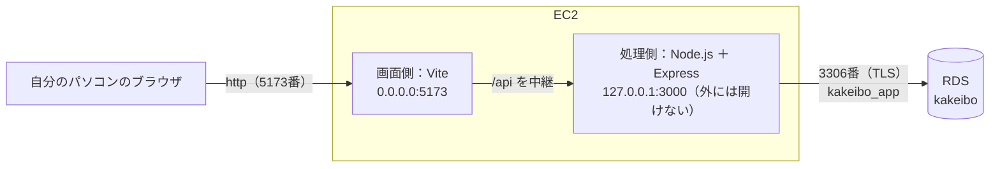
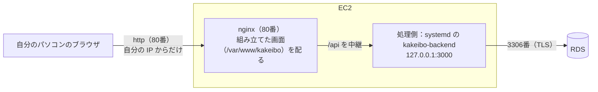

# AWS デプロイガイド

このアプリを、**AWS CLI と Terraform** で AWS に置く（デプロイする）ための案内です。マネジメントコンソールは使いません。
コマンドは、VS Code の画面下のターミナル（PowerShell）で、**プロジェクトの一番上のフォルダ**（`syokyu-kadai`）で入力します。

> - どんな形で AWS に置くかは [構成設計書](docs/02_設計/07_構成設計書.md) を参照してください
> - 言葉や考え方は [AWS と Terraform の基礎知識](docs/03_手順書/05_AWSとTerraformの基礎知識.md)、ログインのしかたは [AWS の認証設定の手順書](docs/03_手順書/06_AWSの認証設定の手順書.md) を参照してください

> **このガイドの決まり**：AWS に何かを作る・変える・消すたびに、「**0. 今の状態**」と「**8. 変更の記録**」を書き換えます。段階が進むたびに、手順の章を書き足します。
> GitHub が公開なので、EC2 の住所・アカウント ID などは書きません（`terraform -chdir=infra output` で確かめます）。

---

## 0. 今の状態

**最後に更新した日：2026年11月6日**

### 0-1. 進み具合

| 段階 | 内容 | 状態 |
|---|---|---|
| 第1段階 | EC2 を作り、SSH で入れることを確かめる | ✅ 完了（2026年11月4日） |
| 第2段階 | EC2 に Node.js を入れる（Terraform の `user_data` で、起動したときに自動で入れる） | ✅ 完了（2026年11月5日） |
| 第3段階 | RDS を作り、EC2 からつなぐ（EC2 には確かめ用の `mysql` コマンドも自動で入れる） | ✅ 完了（2026年11月5日） |
| 第4段階 | アプリを載せて、自分のパソコンのブラウザで確かめる（GitHub の `develop` を取ってきて、手で起動する） | ✅ 画面が出ることを確認（2026年11月6日）。直したアプリの載せ替え（`git pull`）も確認。確かめたあと、全部消した |
| **第5段階** | **フロントエンド・バックエンドを本番らしい形でデプロイする（nginx・systemd・80番、`deploy.ps1`）** | **✅ 完了（2026年11月6日。4-5、[構成設計書](docs/02_設計/07_構成設計書.md) の 4-8）**。何もない状態からも `deploy.ps1` 1行で載せられることを確認。確かめたあと、全部消した |

### 0-2. 今 AWS にあるもの（家計簿アプリのもの）

| もの | 名前 | 作り方 | 状態 | 料金（1日） |
|---|---|---|---|---|
| EC2 | `kakeibo-app`（t4g.small・Amazon Linux 2023・ディスク 8GB・起動したときに Node.js 26.13.0・mysql 8.4.9・git・nginx を自動で入れ、処理側を systemd に登録する） | Terraform | **⚪ 消した**（2026年11月6日。第5段階を確かめたあと、料金がかからないようにするため） | 0 ドル |
| 門番（EC2） | `kakeibo-app`（入口：22番・80番を自分の IP からだけ） | Terraform | ⚪ 消した | 0 ドル |
| SSH の鍵（AWS に登録した公開鍵） | `kakeibo-ec2` | Terraform | ⚪ 消した（パソコンの中の鍵 `~/.ssh/kakeibo-ec2` は残している） | 0 ドル |
| RDS | `kakeibo-db`（MySQL 8.4.11・db.t4g.micro・ディスク 20GB 暗号化・インターネットからはつなげない・バックアップ1日分・時刻は Asia/Tokyo） | Terraform | **⚪ 消した**（2026年11月6日。データも控えも残っていない） | 0 ドル |
| 門番（RDS） | `kakeibo-db`（入口：3306番を EC2 の門番からだけ） | Terraform | ⚪ 消した | 0 ドル |
| RDS の設定・サブネットのまとまり | `kakeibo-mysql84`・`kakeibo-db` | Terraform | ⚪ 消した | 0 ドル |
| パスワード（2つ） | SSM パラメータストア `/kakeibo/db/admin-password`（管理者）・`/kakeibo/db/app-password`（アプリ用） | Terraform | ⚪ 消した（次に作るときは、新しいパスワードがその場で作られる） | 0 ドル |
| S3 バケット（Terraform の記録） | `kakeibo-tfstate-（アカウントID）` | AWS CLI（2-2） | 🟢 あり（次に作るときも使うので残す） | ほぼ 0 ドル |

- **今の料金の合計：ほぼ 0 ドル**（S3 バケットの小さなファイルだけ）
- 次に作るときは、3章の `plan` → `apply`（13個。RDS は10分ほど）のあと、**4-5 の `.\infra\deploy.ps1` の1行**でアプリを載せます（RDS は作り直すと空になりますが、利用者・テーブル・お試しデータも `deploy.ps1` が作ります）
- EC2 を消したあと、次に作るときは、2章の準備（SSH の鍵・S3 バケット・`terraform.tfvars`・`init`）はもう済んでいるので、**3章の `plan` から**始めます。自分の IP アドレスが変わっていたら、先に 2-3 で `my_ip` を直します

> **EC2 を残すときの料金**：EC2 を残しておくと、EC2 本体が無料（2026年12月31日までの無料トライアル）でも、公開の住所（1日約 0.12 ドル）とディスク（1日約 0.03 ドル）の料金がかかります。止めても、ディスクの料金はかかります。そのため、使わないあいだは消しておき、使うときに作り直します。

### 0-3. 今の状態を自分で確かめるコマンド

```powershell
$env:AWS_PROFILE = "kakeibo"
# Terraform で作ったものの一覧と、EC2 の住所など
terraform -chdir=infra state list
terraform -chdir=infra output
# 家計簿の札（Project = kakeibo）が付いた、AWS にあるものの一覧
aws resourcegroupstaggingapi get-resources --tag-filters Key=Project,Values=kakeibo --query "ResourceTagMappingList[].ResourceARN"
# EC2 が動いているか
aws ec2 describe-instances --filters Name=tag:Project,Values=kakeibo --query "Reservations[].Instances[].[InstanceId,State.Name]" --output text
```

---

## 1. このガイドでやること

一気に全部を作らず、**段階ごとに作って確かめます**（[構成設計書](docs/02_設計/07_構成設計書.md) の 1章）。このガイドには、今の段階までの手順を書き、段階が進むごとに書き足します。

| 章 | すること | AWS が変わるか | お金 |
|---|---|---|---|
| 2 | はじめの1回だけの準備（SSH の鍵・記録の置き場所・設定の値） | S3 バケットを1つ作る | ほぼ 0 円 |
| 3 | Terraform で EC2（第3段階からは RDS も）を作る（`plan` → `apply`） | **変わる** | **かかり始める**（EC2 だけなら1日約 0.15 ドル、RDS も入れると約 0.85 ドル。クレジットから引かれる） |
| 4 | EC2 に SSH で入って確かめる（4-2：Node.js、4-3：RDS、4-4：第4段階のアプリ（仮の形）、**4-5：第5段階のアプリ（`deploy.ps1`）**） | EC2・RDS の中が変わる（4-4・4-5） | — |
| 5 | 自分の IP アドレスが変わったとき | 門番を変える | — |
| 6 | 片付け（確かめが終わったら） | **消える** | 止まる |
| 7 | 困ったとき | — | — |
| 8 | 変更の記録 | — | — |

### 関係するファイル（第4段階まで）

```
infra/
├── versions.tf                ← Terraform と AWS プロバイダーの版、記録の置き場所（S3）、札
├── variables.tf               ← 外から渡す値（自分の IP アドレス、SSH の公開鍵、EC2 の大きさ、Node.js・mysql・RDS の版、画面側のポート など）
├── network.tf                 ← デフォルト VPC とサブネットを読む（作らない）
├── security.tf                ← 門番（EC2：22番・80番を自分の IP からだけ／RDS：3306番を EC2 からだけ）
├── compute.tf                 ← EC2・SSH の公開鍵
├── user_data.sh.tftpl         ← EC2 が初めて起動したときに動く準備の手順（第2段階：Node.js／第3段階：mysql コマンド／第4段階：git）
├── database.tf                ← RDS・RDS の設定・管理者とアプリ用のパスワード（第3・4段階）
├── deploy.ps1                 ← アプリ（フロントエンド・バックエンド）を EC2 に載せるスクリプト（第5段階。4-5）
├── outputs.tf                 ← 作ったあとに表示する値
├── terraform.tfvars.example   ← 外から渡す値の見本（GitHub に上げる）
├── terraform.tfvars           ← 外から渡す本物の値（GitHub に上げない）
└── .terraform.lock.hcl        ← プロバイダーの版の記録（Terraform が作る。GitHub に上げる）
```

### 毎回、最初にすること

```powershell
$env:AWS_PROFILE = "kakeibo"
aws sts get-caller-identity --query Arn --output text
```

`…:user/admin-user` と出れば大丈夫です。`ExpiredToken` などのエラーが出たら、ブラウザで AWS のコンソールに admin-user でログインしてから、`aws login --profile kakeibo` でログインし直します（[AWS の認証設定の手順書](docs/03_手順書/06_AWSの認証設定の手順書.md) の 3章）。

---

## 2. はじめの1回だけの準備

### 2-1. SSH の鍵を作る

EC2 に入るための鍵です。**秘密鍵はパソコンにだけ置き、誰にも渡しません**（GitHub にも上げません）。

```powershell
ssh-keygen -t ed25519 -f "$HOME\.ssh\kakeibo-ec2" -C "kakeibo-ec2"
```

パスフレーズを聞かれたら、何も入れずに Enter を2回押します。次の2つのファイルができます。

| ファイル | 中身 |
|---|---|
| `C:\Users\坂本　順治\.ssh\kakeibo-ec2` | 秘密鍵（誰にも渡さない） |
| `C:\Users\坂本　順治\.ssh\kakeibo-ec2.pub` | 公開鍵（Terraform が AWS に登録する） |

### 2-2. Terraform の記録（ステート）の置き場所を作る

Terraform 自身の記録を入れる S3 バケットです。Terraform より先に、AWS CLI で作ります。

```powershell
$account = aws sts get-caller-identity --query Account --output text
$bucket = "kakeibo-tfstate-$account"
# バケットを作る（東京）
aws s3api create-bucket --bucket $bucket --region ap-northeast-1 --create-bucket-configuration LocationConstraint=ap-northeast-1
# 上書きしても前の版に戻せるようにする
aws s3api put-bucket-versioning --bucket $bucket --versioning-configuration Status=Enabled
# インターネットに公開されないようにする
aws s3api put-public-access-block --bucket $bucket --public-access-block-configuration BlockPublicAcls=true,IgnorePublicAcls=true,BlockPublicPolicy=true,RestrictPublicBuckets=true
# 札を付ける（家計簿のものだと分かるように）
aws s3api put-bucket-tagging --bucket $bucket --tagging 'TagSet=[{Key=Project,Value=kakeibo},{Key=ManagedBy,Value=aws-cli}]'
```

- このバケットは Terraform の外で作るので、`terraform destroy` では消えません。次の段階でも使うので、残しておきます
- バケットの名前にアカウント ID が入るので、名前はコードに書かず、2-4 で渡します

### 2-3. 外から渡す値を書く

1. `infra/terraform.tfvars.example` をコピーして、同じ場所に `infra/terraform.tfvars` という名前で置きます

   ```powershell
   Copy-Item infra\terraform.tfvars.example infra\terraform.tfvars
   ```

2. 自分のパソコンの IP アドレスを調べます

   ```powershell
   (Invoke-RestMethod https://checkip.amazonaws.com).Trim()
   ```

3. `infra/terraform.tfvars` を開き、`my_ip` を 2. で調べた IP アドレスに書きかえて保存します

`terraform.tfvars` は `.gitignore` に入っているので、GitHub には上がりません。

### 2-4. Terraform の準備をする（init）

```powershell
$account = aws sts get-caller-identity --query Account --output text
terraform -chdir=infra init -backend-config="bucket=kakeibo-tfstate-$account"
```

`Terraform has been successfully initialized!` と出れば準備できています。

---

## 3. Terraform で EC2 を作る

### 3-1. 何が作られるか確かめる（plan）

```powershell
terraform -chdir=infra plan '-out=kakeibo.tfplan'
```

- `'-out=kakeibo.tfplan'` は、**引用符（`'`）で囲みます**。囲まないと、PowerShell が `.` のところで2つに分けてしまい、`Error: Too many command line arguments` になります（2026年11月4日に実際に起きました）
- **AWS には何も作られません**。作るものの一覧が表示されるだけです
- 最後の行が `Plan: 13 to add, 0 to change, 0 to destroy.` になっていることを確かめます（第4段階から。EC2 のまわりの6つ：SSH の鍵・門番・門番の入口2つ・出口1つ・EC2、RDS のまわりの7つ：RDS・RDS の設定・サブネットのまとまり・RDS の門番・その入口・管理者とアプリ用のパスワード）
- RDS（`aws_db_instance`）が `publicly_accessible = false`、RDS の門番の入口（`mysql_from_app`）が 3306番を EC2 の門番から（`referenced_security_group_id`）になっていることを確かめます
- 門番の入口（`aws_vpc_security_group_ingress_rule`）の `cidr_ipv4` が、**自分の IP アドレス/32** になっていることを確かめます（`0.0.0.0/0` ではないこと）
- `-out=kakeibo.tfplan` で、確かめた内容をファイルに残します。次の `apply` で、**確かめたとおりのもの**だけが作られます

### 3-2. 本当に作る（apply）

> **ここからお金がかかり始めます**（第3段階からは RDS も入るので1日約 0.85 ドル。無料プランのクレジットから引かれます）。確かめが終わったら、6章ですぐ消します。RDS は作るのに10分ほどかかります。

```powershell
terraform -chdir=infra apply kakeibo.tfplan
Remove-Item infra\kakeibo.tfplan
```

- 1〜2分で終わります。終わると、次のような値が表示されます（あとからでも `terraform -chdir=infra output` で見られます）

  | 値 | 意味 |
  |---|---|
  | `public_ip` | EC2 の公開の住所（止めて動かすと変わる） |
  | `ssh_command` | EC2 に SSH で入るコマンド |
  | `app_url` | アプリを開くアドレス（`http://（EC2 の住所）/`。4-5 でアプリを載せたあとに開ける） |
  | `instance_id` | EC2 の番号 |

- 作ったら、「0. 今の状態」と「8. 変更の記録」を書き換えます

## 4. EC2 に SSH で入って確かめる

EC2 は、作ってから起動するまで1分ほどかかります。

```powershell
$ip = terraform -chdir=infra output -raw public_ip
ssh -i "$HOME\.ssh\kakeibo-ec2" ec2-user@$ip
```

- 初めてつなぐときは `Are you sure you want to continue connecting (yes/no/[fingerprint])?` と聞かれるので、半角で `yes` と打ちます
- 入れたら、次のコマンドで確かめます

  ```bash
  cat /etc/os-release | head -n 2   # Amazon Linux 2023 と出ればよい
  uname -m                          # aarch64（Arm）と出ればよい
  df -h /                           # ディスクが 8GB ほど
  exit                              # EC2 から出る
  ```

- 自分のパソコン以外からは入れないことも確かめます（入口が自分の IP アドレスだけで、`0.0.0.0/0` がないこと）

  ```powershell
  aws ec2 describe-security-groups --filters Name=group-name,Values=kakeibo-app --query "SecurityGroups[].IpPermissions[].[FromPort,IpRanges[].CidrIp]" --output json
  ```

  `22` と `80` の2つだけが、自分の IP アドレス（`…/32`）で出れば大丈夫です（第4段階までは `80` のかわりに `5173`）

### 4-2. Node.js が入ったか確かめる（第2段階）

EC2 は、初めて起動したときに、`infra/user_data.sh.tftpl` の手順で Node.js を自動で入れます（1分ほどかかります）。SSH で入ってから、次のコマンドで確かめます。

```bash
cloud-init status --wait          # 準備が終わるまで待つ。「status: done」と出ればよい（「status: error」なら失敗）
sudo tail -n 3 /var/log/cloud-init-output.log   # 最後に「第2段階の準備が終わりました（Node.js 26.13.0）」と出ればよい
node -v                           # v26.13.0（自分のパソコンと同じ）
npm -v                            # 11.20.0（自分のパソコンと同じ）
node -e "console.log(1+2)"        # 3 と出れば、Node.js が動いている
```

- `user_data.sh.tftpl` を直して `plan` すると、`aws_instance.app must be replaced`（EC2 を作り直す）と出ます。起動したときの手順は、初めて起動したときにしか動かないためです。作り直すと EC2 の住所も変わるので、`terraform -chdir=infra output` で確かめ直します

### 4-3. EC2 から RDS につながるか確かめる（第3段階）

RDS は作るのに10分ほどかかります（`apply` が終わるまで待ちます）。RDS はインターネットからつなげないので、**EC2 に入ってから**つなぎます。

1. EC2 に SSH で入り、`mysql` コマンドが入ったか確かめます（4-2 と同じく、`cloud-init status --wait` で準備が終わるまで待ちます）

   ```bash
   sudo grep "準備が終わりました" /var/log/cloud-init-output.log | grep -v "^+"   # 第2段階・第3段階の2行が出ればよい
   mysql --version                                                                # Ver 8.4.9 と出ればよい
   exit
   ```

2. 自分のパソコンで、管理者のパスワードを SSM パラメータストアから読み、**画面にもファイルにも出さずに**、SSH の中だけで EC2 に渡して、EC2 から RDS につなぎます

   ```powershell
   $ip = terraform -chdir=infra output -raw public_ip
   $db = terraform -chdir=infra output -raw db_endpoint
   $user = terraform -chdir=infra output -raw db_admin_username
   $pw = aws ssm get-parameter --name (terraform -chdir=infra output -raw db_admin_password_parameter) --with-decryption --query Parameter.Value --output text
   $b64 = [Convert]::ToBase64String([Text.Encoding]::UTF8.GetBytes($pw)); $pw = $null
   @"
   export MYSQL_PWD="`$(echo '$b64' | base64 -d)"
   mysql -h $db -u $user --ssl-mode=REQUIRED --table kakeibo -e "SELECT VERSION(), DATABASE(), @@time_zone, NOW(); SHOW STATUS LIKE 'Ssl_version';"
   "@ | ssh -i "$HOME\.ssh\kakeibo-ec2" "ec2-user@$ip" "tr -d '\r' | bash -s"
   $b64 = $null
   ```

   | 出てくるもの | よい状態 |
   |---|---|
   | `VERSION()` | `8.4.11` |
   | `DATABASE()` | `kakeibo` |
   | `@@time_zone` | `Asia/Tokyo`（`NOW()` も日本時間） |
   | `Ssl_version` | `TLSv1.3` など（EC2 と RDS のあいだも暗号化されている） |

3. **EC2 以外からはつながらない**ことを確かめます

   ```powershell
   # false と出ればよい（インターネットからはつなげない）
   aws rds describe-db-instances --db-instance-identifier kakeibo-db --query "DBInstances[].PubliclyAccessible" --output text
   # 3306番の入口が、EC2 の門番からだけになっていればよい（IP アドレスの入口がない）
   aws ec2 describe-security-groups --filters Name=group-name,Values=kakeibo-db --query "SecurityGroups[].IpPermissions[].{port:FromPort,from_ip:IpRanges[].CidrIp,from_group:UserIdGroupPairs[].GroupId}" --output json
   ```

### 4-4. アプリを載せて、ブラウザで確かめる（第4段階：仮の形）

> **この節は第4段階（開発用の Vite・手で起動・5173番）の記録です。今は 4-5 の形（nginx・systemd・80番、`deploy.ps1`）で載せます。** EC2 の門番も 80番に変えたので、この節の 5173番の手順はそのままでは使えません。

画面側と処理側を、同じ EC2 の中で動かします。アプリのファイルは **GitHub の `develop` ブランチから取ってきて**、**手で起動**します（2026年11月6日に坂本さんが選んだ形）。



1. **アプリを取ってきて、部品を入れる**（EC2 に SSH で入ってから）

   ```bash
   cd ~
   git clone --branch develop --single-branch https://github.com/junji-sakamoto/kakeibo-app.git
   cd ~/kakeibo-app/backend  && npm ci --omit=dev   # 処理側：本番に要る部品だけ
   cd ~/kakeibo-app/frontend && npm ci              # 画面側：Vite も使うので、開発用の部品も入れる
   ```

2. **RDS に、アプリ用の利用者・テーブル・お試しデータを作る**（最初の1回だけ）。パスワードは自分のパソコンで SSM パラメータストアから読み、**画面にもファイルにも出さずに**、SSH の中だけで渡します

   ```powershell
   $ip = terraform -chdir=infra output -raw public_ip
   $db = terraform -chdir=infra output -raw db_endpoint
   $admin = terraform -chdir=infra output -raw db_admin_username
   $adminB64 = [Convert]::ToBase64String([Text.Encoding]::UTF8.GetBytes((aws ssm get-parameter --name (terraform -chdir=infra output -raw db_admin_password_parameter) --with-decryption --query Parameter.Value --output text)))
   $appB64 = [Convert]::ToBase64String([Text.Encoding]::UTF8.GetBytes((aws ssm get-parameter --name (terraform -chdir=infra output -raw db_app_password_parameter) --with-decryption --query Parameter.Value --output text)))
   @"
   set -euo pipefail
   cd ~/kakeibo-app/database
   export MYSQL_PWD="`$(echo '$adminB64' | base64 -d)"
   APP_PW="`$(echo '$appB64' | base64 -d)"
   M="mysql -h $db -u $admin --ssl-mode=REQUIRED --default-character-set=utf8mb4 kakeibo"
   `$M -e "CREATE USER 'kakeibo_app'@'%' IDENTIFIED BY '`$APP_PW'; GRANT SELECT, INSERT, UPDATE, DELETE ON kakeibo.* TO 'kakeibo_app'@'%';"
   for f in sql/01_create_tables.sql sql/02_insert_categories.sql sql/03_insert_sample_records.sql; do `$M < "`$f"; echo "実行しました: `$f"; done
   "@ | ssh -i "$HOME\.ssh\kakeibo-ec2" "ec2-user@$ip" "tr -d '\r' | bash -s"
   $adminB64 = $null; $appB64 = $null
   ```

   - アプリ用の利用者 `kakeibo_app` ができるのは、記録とカテゴリの読み書き（SELECT・INSERT・UPDATE・DELETE）だけです。テーブルを消すことはできません
   - テーブルとお試しデータは、自分のパソコンのデータベースと同じ SQL（`database/sql/`）を使います。カテゴリ17件・記録28件になります

3. **処理側の設定（`backend/.env`）を、EC2 の中だけに置く**（最初の1回だけ）。パスワードが入るので、`ec2-user` だけが読めるようにします（`umask 077`）。GitHub には上がりません（`.gitignore`）

   ```powershell
   $ip = terraform -chdir=infra output -raw public_ip
   $db = terraform -chdir=infra output -raw db_endpoint
   $appB64 = [Convert]::ToBase64String([Text.Encoding]::UTF8.GetBytes((aws ssm get-parameter --name (terraform -chdir=infra output -raw db_app_password_parameter) --with-decryption --query Parameter.Value --output text)))
   @"
   set -euo pipefail
   cd ~/kakeibo-app/backend
   umask 077
   cat > .env <<EOF
   HOST=127.0.0.1
   PORT=3000
   DB_HOST=$db
   DB_PORT=3306
   DB_USER=kakeibo_app
   DB_PASSWORD=`$(echo '$appB64' | base64 -d)
   DB_NAME=kakeibo
   EOF
   ls -l .env
   "@ | ssh -i "$HOME\.ssh\kakeibo-ec2" "ec2-user@$ip" "tr -d '\r' | bash -s"
   $appB64 = $null
   ```

4. **処理側と画面側を起動する**（EC2 に SSH で入ってから）。`nohup` を付けると、SSH を切っても止まりません。画面側は `--host 0.0.0.0` で、EC2 の外（自分のパソコン）からも受け付けるようにします（`vite.config.js` は `127.0.0.1` のままで、起動のときだけ変える）

   ```bash
   cd ~/kakeibo-app/backend  && nohup npm start > ~/backend.log 2>&1 < /dev/null &
   cd ~/kakeibo-app/frontend && nohup npm run dev -- --host 0.0.0.0 > ~/frontend.log 2>&1 < /dev/null &
   sleep 8
   tail -n 3 ~/backend.log ~/frontend.log            # 「処理側を起動しました」「VITE … ready」と出ればよい
   sudo ss -tlnp | awk '/LISTEN/ {print $4}'         # 127.0.0.1:3000 と 0.0.0.0:5173 があればよい
   curl -s http://127.0.0.1:5173/api/health          # {"status":"ok"}（画面側 → 処理側 → RDS がつながっている）
   ```

5. **自分のパソコンのブラウザで開く**

   ```powershell
   terraform -chdir=infra output -raw frontend_url
   ```

   表示された `http://（EC2 の住所）:5173/` を開き、記録一覧（お試しデータ）・年間・カテゴリの画面が出ることを確かめます

6. **直したアプリを載せ替える**（GitHub の `develop` に PR をマージしたあと。EC2 に SSH で入ってから）

   ```bash
   cd ~/kakeibo-app && git pull --ff-only     # develop の新しい変更を取ってくる
   # 部品（package.json）が変わったときだけ：cd backend && npm ci --omit=dev ／ cd frontend && npm ci
   pkill -f "[n]ode .*vite"                    # 画面側を止める
   cd ~/kakeibo-app/frontend && nohup npm run dev -- --host 0.0.0.0 > ~/frontend.log 2>&1 < /dev/null &
   # 処理側（backend）を直したときは、処理側も止めて起動し直す：
   #   pkill -f "[s]rc/server.js"; cd ~/kakeibo-app/backend && nohup npm start > ~/backend.log 2>&1 < /dev/null &
   ```

   - 2026年11月6日に、メニューの名前の変更（PR #18）をこの手順で載せ替え、AWS の上でも新しい名前が出ることを確かめました
   - 止める命令は `pkill -f "[n]ode .*vite"` のように、**最初の1文字を `[ ]` で囲みます**。`pkill -f vite` と書くと、その命令を送った SSH のコマンドの中の「vite」という文字にも当たり、**SSH ごと止まってしまいます**（2026年11月6日に実際に起きました。`[n]` と書くと、コマンドの文字そのものには当たらなくなります）

7. **止めるとき**（EC2 に SSH で入ってから）

   ```bash
   pkill -f "[n]ode .*vite"; pkill -f "[s]rc/server.js"
   ```

   EC2 を `terraform destroy` で消すときは、止めなくても一緒に消えます

### 4-5. アプリを本番らしい形で載せる（第5段階：`deploy.ps1`）

フロントエンドとバックエンドを、それぞれ本番らしい形で載せます（[構成設計書](docs/02_設計/07_構成設計書.md) の 4-8）。



| | 動かし方 | 準備するところ |
|---|---|---|
| フロントエンド | `npm run build` で組み立てたファイルを、**nginx** が 80番で配る。`/api` は nginx が処理側に中継する。ないアドレス（`/categories` など）でも `index.html` を返す | nginx・nginx の設定は、EC2 が起動したときに自動で入る（`infra/user_data.sh.tftpl`） |
| バックエンド | **systemd** の `kakeibo-backend` として動かす。EC2 が起動したら自動で動き、止まったら3秒後に自動で起動し直す | systemd への登録は、EC2 が起動したときに自動で行う（`.env` が置かれるまでは動かない） |

**載せ方：3章で `apply` したあと、次の1行を打ちます**（初めてでも、2回目からでも同じ）

```powershell
.\infra\deploy.ps1
```

`deploy.ps1` は、次のことを順番に行います。何度動かしてもよく、すでにあるもの（RDS の利用者・テーブル・データ）は作り直しません。

| 順番 | すること |
|---|---|
| 1 | EC2 の起動の準備（Node.js・mysql・git・nginx・systemd の登録）が終わるのを待つ |
| 2 | GitHub の `develop` を取ってくる（初めては `git clone`、2回目からは取りこみ直す）。ほかのブランチは `-Branch 名前` |
| 3 | 処理側の部品を入れる（`npm ci --omit=dev`） |
| 4 | RDS に、アプリ用の利用者 `kakeibo_app`（SELECT・INSERT・UPDATE・DELETE だけ）とテーブル・お試しデータを作る（**ないときだけ**） |
| 5 | 処理側の設定（`backend/.env`、`ec2-user` だけが読める）を書き、`kakeibo-backend` を起動し直す |
| 6 | 画面側の部品を入れて組み立て（`npm ci`・`npm run build`）、`/var/www/kakeibo` に置く |
| 7 | 自分のパソコンから、画面と `/api/health` を確かめる |

- パスワードは、自分のパソコンで SSM パラメータストアから読み、画面にもファイルにも出さずに、SSH の中だけで EC2 に渡します
- **載せられるのは GitHub に上げたものだけ**です（EC2 は GitHub から取ってきます）。直したら、PR をマージしてから `deploy.ps1` を動かします
- 最後に `載せ終わりました：http://（EC2 の住所）/` と出れば成功です。ブラウザでそのアドレスを開きます

**確かめること**

```powershell
$ip = terraform -chdir=infra output -raw public_ip
# 画面と、再読み込みしたときの画面（どれも 200 ならよい）
foreach ($p in '/', '/categories', '/yearly?year=2026', '/records/new') { "$p : $((Invoke-WebRequest "http://$ip$p" -UseBasicParsing).StatusCode)" }
# nginx を通した API
Invoke-RestMethod "http://$ip/api/health"
```

EC2 の中では、次のように確かめます（SSH で入ってから）。

```bash
systemctl is-active nginx kakeibo-backend            # active が2つ出ればよい
sudo journalctl -u kakeibo-backend -n 20 --no-pager  # 処理側の記録（エラーが出ていないか）
sudo ss -tlnp | awk '/LISTEN/ {print $4}'            # 0.0.0.0:80 と 127.0.0.1:3000 があればよい
```

## 5. 自分の IP アドレスが変わったとき

家のネットの契約によっては、IP アドレスが変わることがあります。変わると、SSH でつながらなくなります（`Connection timed out`）。

1. 2-3 の 2. で、今の IP アドレスを調べます
2. `infra/terraform.tfvars` の `my_ip` を書きかえます
3. 門番の入口だけが変わることを確かめてから、変えます

   ```powershell
   terraform -chdir=infra plan '-out=kakeibo.tfplan'
   terraform -chdir=infra apply kakeibo.tfplan
   Remove-Item infra\kakeibo.tfplan
   ```

   plan に出るのが `aws_vpc_security_group_ingress_rule` の2つだけであることを確かめます

## 6. 片付け（確かめが終わったら）

> EC2 と RDS が消えます。EC2 の中に入れたものも、**RDS の中のデータも消えます**（消すときの控えは取らない設定）。次の段階に進むときは、3章からもう一度作ります（Terraform なので、同じものがすぐできます。RDS は10分ほどかかります）。

1. Terraform で作ったものを消します。消すものの一覧が出るので、確かめてから `yes` と打ちます。デフォルト VPC は Terraform で作ったものではないので消えません

   ```powershell
   terraform -chdir=infra destroy
   ```

2. 家計簿のものが残っていないか確かめます

   ```powershell
   # Terraform の記録が空になっていればよい（何も出ない）
   terraform -chdir=infra state list
   # EC2 が terminated（消えた状態）になっていればよい
   aws ec2 describe-instances --filters Name=tag:Project,Values=kakeibo --query "Reservations[].Instances[].[InstanceId,State.Name]" --output text
   # RDS が見つからなければよい（DBInstanceNotFound と出る）
   aws rds describe-db-instances --db-instance-identifier kakeibo-db --query "DBInstances[].DBInstanceStatus" --output text
   ```

   - 札で探す `aws resourcegroupstaggingapi get-resources --tag-filters Key=Project,Values=kakeibo` は、消したばかりのものもしばらく出てきます（反映に時間がかかるしくみのため。2026年11月4日に確認）。消した直後は、上の2つで確かめます

3. 「0. 今の状態」と「8. 変更の記録」を書き換えます

- S3 バケット（Terraform の記録）と SSH の鍵は、次の段階で使うので残します
- 講師の確認まで全部終わって、もう作り直さないときの片付け（S3 バケットを消すなど）は、最後の段階で書き足します

## 7. 困ったとき

| 起きたこと | 考えられる原因 | どうするか |
|---|---|---|
| `terraform` で `No valid credential sources found`・`ExpiredToken` | ログインの期限切れ、または `$env:AWS_PROFILE` の指定忘れ | 「毎回、最初にすること」を行う |
| `terraform` で `Failed to load plugin schemas` | Norton が割り込んでいる | [AWS の認証設定の手順書](docs/03_手順書/06_AWSの認証設定の手順書.md) の 8章 |
| `terraform init` で、バケットが見つからない | 2-2 のバケットを作っていない、または名前が違う | 2-2 を行う。`-backend-config` のバケット名を確かめる |
| `plan` で `Error: Too many command line arguments` | `-out=kakeibo.tfplan` を引用符で囲んでいない（PowerShell が `.` で分けてしまう） | `'-out=kakeibo.tfplan'` のように `'` で囲む |
| `plan` で `my_ip` のエラー | `terraform.tfvars` に IP アドレスが書かれていない、または形が違う | 2-3 を行う（`/32` は付けない） |
| `ssh` で `Connection timed out` | 自分の IP アドレスが変わった、または EC2 がまだ起動していない | 1分ほど待つ。それでもだめなら 5章 |
| `ssh` で `Permission denied (publickey)` | 秘密鍵の場所が違う、または利用者の名前が違う | `-i "$HOME\.ssh\kakeibo-ec2"` と `ec2-user@` を確かめる |
| `node -v` で `libatomic.so.1: cannot open shared object file` | Node.js が使う部品（libatomic）が入っていない（Amazon Linux 2023 には初めから入っていない） | `user_data.sh.tftpl` で、先に `dnf -y install libatomic` をしている（2026年11月5日に直した）。手で直すときは `sudo dnf -y install libatomic` |
| `mysql: command not found`（起動の記録に `404 for https://repo.mysql.com/yum/…/el/2023.…/`） | MySQL の置き場所のフォルダの番号（`$releasever`）が、Amazon Linux 2023 では「2023.…」になり、ないフォルダを探している | `user_data.sh.tftpl` で、置き場所の登録の `$releasever` を `9` に置きかえている（2026年11月5日に直した） |
| RDS につなぐと `Access denied` | パスワードが違う、または利用者の名前が違う | 4-3 の 2. のとおり、SSM パラメータストアから読んだパスワードと `db_admin_username` を使う |
| RDS につなぐと止まったまま（`Can't connect to MySQL server`） | RDS がまだ作り終わっていない、または EC2 以外から（自分のパソコンから）つなごうとしている | `apply` が終わったか確かめる。RDS には EC2 からだけつなげる（そういう決まり） |
| パソコンのブラウザで `http://（EC2 の住所）/` が開けない（第5段階） | nginx が動いていない、または IP アドレスが変わった | EC2 で `systemctl is-active nginx`。IP が変わったなら 5章 |
| 「準備中です。アプリの画面はまだ置かれていません。」と出る | まだ `deploy.ps1` を動かしていない | 4-5 の `.\infra\deploy.ps1` を動かす |
| 画面は出るが「サーバーとの通信に失敗しました」（第5段階） | 処理側（`kakeibo-backend`）が止まっている、または RDS につながっていない | EC2 で `systemctl status kakeibo-backend` と `sudo journalctl -u kakeibo-backend -n 30` を見る。`deploy.ps1` をもう一度動かす |
| `deploy.ps1` が「EC2 の中の手順が失敗しました」で止まる | 1〜6 のどこかで失敗した | 表示された「=== 〇. …」の最後の段のところを見る。直したら、もう一度動かす（何度動かしてもよい） |
| パソコンのブラウザで `http://（EC2 の住所）:5173/` が開けない（第4段階） | 画面側が起動していない、`--host 0.0.0.0` を付け忘れた（EC2 の中だけで待ち受けている）、または IP アドレスが変わった | EC2 で `sudo ss -tlnp` を見て、`0.0.0.0:5173` があるか確かめる。なければ 4-4 の 4. で起動し直す。IP が変わったなら 5章 |
| 画面は出るが「サーバーとの通信に失敗しました」（S01） | 処理側が止まっている、または RDS につながっていない | EC2 で `tail -n 20 ~/backend.log` と `curl -s http://127.0.0.1:3000/api/health` を見る。`.env` の値（4-4 の 3.）を確かめる |
| `pkill` を打ったら SSH が切れた（終了コード 255） | `pkill -f vite` が、SSH で送ったコマンドの文字にも当たって、SSH ごと止めた | 4-4 の 6. のとおり `pkill -f "[n]ode .*vite"` と書く。切れたあとは、SSH で入り直して、画面側を起動し直す |
| `CREATE USER` で `Operation CREATE USER failed` | アプリ用の利用者がもうある（4-4 の 2. を2回行った） | 1回目でできているので、そのままでよい |
| `cloud-init status` が `status: error` | 起動したときの準備の手順のどこかで失敗した | `sudo tail -n 30 /var/log/cloud-init-output.log` で、失敗した場所を見る。手順を直したら `plan`・`apply` で EC2 を作り直す |
| `ssh` で `REMOTE HOST IDENTIFICATION HAS CHANGED` | EC2 を作り直して、住所が前と同じになった | `ssh-keygen -R （public_ip）` で古い鍵を忘れさせてから、つなぎ直す |

## 8. 変更の記録

AWS に作ったもの・変えたもの・消したものと、確かめた結果です。新しいものを下に書き足します。

| 日付 | したこと | 結果 |
|---|---|---|
| 2026年11月4日 | 第1段階の Terraform のファイルの `validate`・`fmt -check` | 合格（AWS には何もしていない） |
| 2026年11月4日 | 2章：SSH の鍵・S3 バケット（前の版に戻せる・公開しない・暗号化）・`terraform.tfvars`・`init` | できた。**S3 バケットを作った** |
| 2026年11月4日 | 3章：`plan` → `apply` | `Plan: 6 to add`。門番の入口は 22番・5173番とも `（自分の IP）/32` だけ。`apply` で6つとも作れた（EC2 は13秒）。**EC2・門番・SSH の鍵を作った**。途中で `-out=kakeibo.tfplan` を引用符で囲まずにエラーになった → ガイドを直した |
| 2026年11月4日 | 4章：SSH で入る | 入れた（`ec2-user`）。Amazon Linux 2023・`aarch64`（Arm）・ディスク 8.0G・メモリ 1.8Gi。nginx・Node.js はまだ入っていない（待ち受けているのは 22番だけ） |
| 2026年11月4日 | 4章：門番 | AWS から読み取って、入口が 22番・5173番の2つだけ・どちらも `（自分の IP）/32` であることを確認。3000番・80番には、自分のパソコンからもつながらない |
| 2026年11月4日 | ガイドを `docs/03_手順書/07_AWSへの公開の手順書.md` から、プロジェクトの一番上の `AWSデプロイガイド.md` に移し、「0. 今の状態」を足した | — |
| 2026年11月4日 | 6章：`terraform destroy`（EC2 を残すと1日約 0.15 ドルかかるため） | `Plan: 6 to destroy` を確かめてから消した。**EC2・門番・SSH の鍵（AWS の方）を消した**。EC2 は terminated、ディスクも消えた（`InvalidVolume.NotFound`）。残っているのは S3 バケットだけ。札で探す一覧には、消した直後もしばらく出てくることが分かった → 6章に書き足した |
| 2026年11月5日 | 第2段階：`user_data.sh.tftpl`（Node.js 26.13.0 を公式のファイルから入れ、SHASUMS256.txt で確かめる）を作り、`plan` → `apply` | `Plan: 6 to add`（門番の入口は自分の IP だけ）。**EC2・門番・SSH の鍵を作り直した** |
| 2026年11月5日 | 4-2：Node.js を確かめる | **失敗**：`cloud-init status` が `error`、`node -v` で `libatomic.so.1: cannot open shared object file`。Amazon Linux 2023 に libatomic が入っていないため |
| 2026年11月5日 | `user_data.sh.tftpl` に `dnf -y install libatomic tar xz` を足して、`plan` → `apply` | `Plan: 1 to add, 1 to destroy`（EC2 だけ作り直し）。**EC2 を作り直した** |
| 2026年11月5日 | 4-2：Node.js を確かめる | **成功**：`status: done`、`node v26.13.0`・`npm 11.20.0`（自分のパソコンと同じ）、`node -e` で計算できた、CPU は arm64。待ち受けているのは 22番だけ |
| 2026年11月5日 | 自分のパソコンのブラウザから、EC2 の画面が見えるかの確かめ（一時的）：SSH で `sudo dnf -y install nginx` し、`/etc/nginx/nginx.conf` の `listen 80` を `5173` に変えて起動 | nginx 1.30.6。EC2 の中でも、自分のパソコンからも `http://（EC2 の住所）:5173/` で「Welcome to nginx!」（状態 200）が出た。門番（5173番を自分の IP からだけ）を通って届くことを確認。Terraform には書いていない（EC2 を消すと消える）。坂本さんもブラウザで確認した |
| 2026年11月5日 | 6章：`terraform destroy`（いったん終わりにするため、料金がかからない状態にする） | `Plan: 6 to destroy` を確かめてから消した。**EC2・門番・SSH の鍵（AWS の方）を消した**。EC2 は terminated、ディスクも消えた。残っているのは S3 バケットだけ |
| 2026年11月5日 | 第3段階：`database.tf`（RDS・設定・管理者のパスワード）、RDS の門番、EC2 に mysql 8.4.9 を入れる手順を足して、`plan` → `apply` | `Plan: 12 to add`。RDS は `publicly_accessible = false`、門番は 3306番を EC2 の門番からだけ。**EC2・門番・SSH の鍵・RDS・RDS の門番・パスワードなど12個を作った**（RDS は9分） |
| 2026年11月5日 | 4-3：EC2 の準備を確かめる | **失敗**：`status: error`、`mysql: command not found`。MySQL の置き場所の `$releasever` が「2023.…」になって 404 だった |
| 2026年11月5日 | `user_data.sh.tftpl` で `$releasever` を `9` に置きかえて、`plan` → `apply` | `Plan: 1 to add, 1 to destroy`（EC2 だけ作り直し、RDS はそのまま）。**EC2 を作り直した** |
| 2026年11月5日 | 4-3：EC2 から RDS につなぐ | **成功**：`status: done`、`mysql 8.4.9`。EC2 から RDS につながり、MySQL 8.4.11・データベース `kakeibo`・利用者 `kakeibo_admin`・時刻 Asia/Tokyo・utf8mb4・TLSv1.3。RDS は `PubliclyAccessible: false`、RDS の住所は VPC の中だけの住所（172.31.…）、門番は EC2 の門番からだけ、自分のパソコンからは 3306番につながらない |
| 2026年11月5日 | 坂本さんの希望で、EC2 以外から RDS につながらないかを確かめ直した | RDS に付いている門番は `kakeibo-db` だけ、その入口は 3306番を `kakeibo-app` の門番からだけ（IPv4・IPv6・住所の一覧の入口はなし）。`kakeibo-app` が付いているのは今の EC2 の1台だけ。実際に、パソコンからは 3306番につながらず、EC2 からはつながった |
| 2026年11月5日 | 6章：`terraform destroy`（一旦終わりにするため、料金がかからない状態にする） | `Plan: 12 to destroy` を確かめてから消した（RDS は2分）。**EC2・RDS・門番・パスワードなど12個を消した**。RDS は見つからない（DBInstanceNotFound）、RDS の控えも残っていない。残っているのは S3 バケットだけ |
| 2026年11月6日 | 第4段階：EC2 の起動の手順に git を足し、アプリ用のパスワード（SSM）を足して、`plan` → `apply` | `Plan: 13 to add`。**EC2・RDS・門番・パスワード2つなど13個を作った**（RDS は9分）。起動の準備は `status: done`（Node.js 26.13.0・mysql 8.4.9・git 2.50.1） |
| 2026年11月6日 | 4-4 の 1.：`develop` を git clone、`npm ci` | `develop` の最新（PR #16 のマージ）を取ってきた。処理側 76個・画面側 124個の部品が入った |
| 2026年11月6日 | 4-4 の 2.：RDS にアプリ用の利用者・テーブル・お試しデータ | カテゴリ17件・記録28件。`kakeibo_app` は SELECT・INSERT・UPDATE・DELETE だけで、DROP は断られた |
| 2026年11月6日 | 4-4 の 3.〜4.：`.env`（`-rw-------`）、処理側（127.0.0.1:3000）と画面側（0.0.0.0:5173）を nohup で起動 | EC2 の中で `/api/health` が `{"status":"ok"}`（画面側を通しても同じ） |
| 2026年11月6日 | 4-4 の 5.：自分のパソコンから | 画面（タイトル「家計簿」）・API が届いた。2026年10月は記録13件・収入 253,000円・支出 95,400円・差額 157,600円、2026年の合計は 503,000円・200,000円・303,000円（自分のパソコンで動かしたときと同じ）。記録一覧・年間・カテゴリの画面を写真で確認。パソコンから EC2 の 3000番・3306番・80番にはつながらない |
| 2026年11月6日 | 4-4 の 6.：メニューの名前の変更（PR #18）を develop にマージしたあと、EC2 で `git pull --ff-only` して画面側を起動し直した | `develop` が `c3b0dbe`（PR #18 のマージ）になった。1回目は `pkill -f vite` で SSH ごと止まった → `[n]ode .*vite` に直してガイドに書いた。起動し直したあと、パソコンの幅とスマートフォンの幅（360）で「月ごとの記録」「年間の集計」「カテゴリの設定」が出ることを確認 |
| 2026年11月6日 | 6章：`terraform destroy`（料金がかからない状態にする） | `Plan: 13 to destroy` を確かめてから消した（RDS は1分51秒）。**EC2・RDS・門番・パスワード2つなど13個を消した**。RDS は見つからない（DBInstanceNotFound）、控えも残っていない。残っているのは S3 バケットだけ |
| 2026年11月6日 | 第5段階 5-2：門番の入口を 5173番から 80番に、起動の手順に nginx（設定）と systemd の登録を足して、`plan` → `apply` | `Plan: 13 to add`（入口は 22番・80番を自分の IP だけ）。**13個を作った**。起動の準備は第2〜5段階とも終わり、nginx は動き、`kakeibo-backend` は登録済み（`.env` がないので動かない）。80番で「準備中」の画面 |
| 2026年11月6日 | 5-3 バックエンド（手で）：`git clone`・`npm ci --omit=dev`・RDS の準備・`.env`・`systemctl start kakeibo-backend` | `active (running)`、`/api/health` が ok。わざと強制終了（`kill -9`）すると、5秒以内に新しいプログラムで自動で起動し直した（起動し直した回数 1） |
| 2026年11月6日 | 5-4 フロントエンド（手で）：`npm ci`・`npm run build`・`/var/www/kakeibo` に置く | パソコンから画面 200（`Server: nginx` で版は出さない）、`index.html` は `no-cache`・組み立てた JS は1年ためる、`/categories` などの再読み込みも 200、nginx を通した API も ok。3000・3306・5173番にはつながらない |
| 2026年11月6日 | 5-5 まとめて確かめる | 記録・カテゴリの登録・修正・削除、年間から月へ、スマートフォンの幅 360 の5画面：すべて合格（試験用のデータは後片付け）。EC2 を再起動すると、約25秒で nginx と処理側が自動で動き出した |
| 2026年11月6日 | 5-6 `infra/deploy.ps1` を作り、動いている EC2 で動かした（2回目の形） | 利用者・テーブルは作り直さず、データもそのまま（17件・28件）。最後に「載せ終わりました」 |
| 2026年11月6日 | 何もない状態から `deploy.ps1` だけで載せられるか：`destroy`（13個）→ `apply`（13個）→ `deploy.ps1` | **成功**：利用者・テーブル・お試しデータを新しく作り、処理側・画面とも動いた。主な操作の確かめ3つもすべて合格 |
| 2026年11月6日 | 6章：`terraform destroy`（第5段階を確かめたあと、料金がかからない状態にする） | `Plan: 13 to destroy` を確かめてから消した。**13個を消した**。RDS は見つからない、控えも残っていない。残っているのは S3 バケットだけ |
