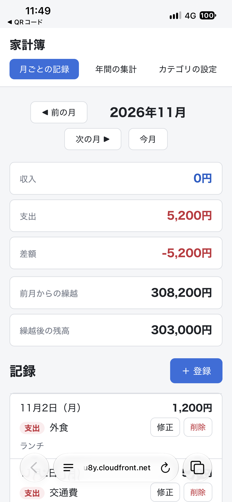
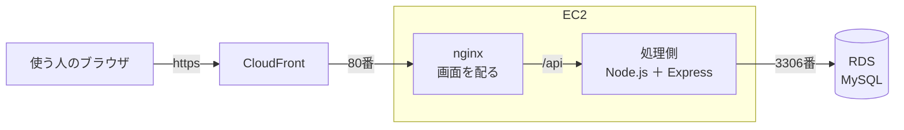

# 家計簿アプリ（kakeibo-app）

スクールの課題で作成した家計簿アプリです。
収入と支出を記録し、月ごとの合計（前月からの繰越と残高を含む）と、年ごとの合計を確認できます。

このファイルが、プロジェクト全体の**入口**です。

## 動作の確認（動画とスクリーンショット）

AWS の本番環境（`https://…cloudfront.net/`）で、主な機能を動かして撮影しました。本番環境は、料金がかからないように、撮影のあとに消しています（[構成設計書](docs/02_設計/07_構成設計書.md) の8章）。

### 動画（機能ごと・字幕つき）

<!-- 動画は GitHub にアップロードしたもの（https://github.com/user-attachments/assets/…）を、それぞれの見出しの下に1行で貼る -->

#### 第1章　月ごとの記録

記録の登録・修正・削除、入力の間違い、前月からの繰越と残高

https://github.com/user-attachments/assets/5f081302-686d-4ff4-b296-959b0f95d1b6

#### 第2章　年間の集計

1年の合計と、1月〜12月の月ごとの合計

https://github.com/user-attachments/assets/8716bdc1-85af-44ff-869b-4858ddb8d3da

#### 第3章　カテゴリの設定

カテゴリの登録・修正・削除、同じ名前や使われているカテゴリの扱い

https://github.com/user-attachments/assets/e3265a70-e4f5-4e87-a61d-86b04297e0b1

#### 第4章　使いやすさと安全

スマートフォンの幅、https、存在しないページ

https://github.com/user-attachments/assets/1f20a9f0-f868-4c70-a835-e79c70517ec7

### スマートフォン（iPhone・携帯の回線で本番環境を開いたところ）



## 技術スタック

課題の条件として、**これまでの学習で使ってきた技術（Java・React・PostgreSQL）とは別の技術**を選びました。

| 部品 | 使ったもの | 選んだ理由（要点） |
|---|---|---|
| 言語 | JavaScript | 画面側と処理側を同じ言語で書ける。書いたものがそのまま動く |
| 画面側 | Vue.js 3・Vue Router・Vite | React の代わりになり、HTML に近い書き方ができる。Vue.js の公式がすすめる作り方 |
| 見た目 | CSS（そのまま書く） | 画面モックで決めた見た目を、そのまま使うため |
| 処理側 | Node.js 26（LTS）・Express 5 | Java の代わり。画面側と同じ JavaScript で書け、利用者と資料が多い |
| 処理側の安全 | helmet | 安全のための HTTP の設定を、まとめて付けられる（Express の公式がすすめる） |
| データベース | MySQL 8.4（LTS） | PostgreSQL の代わり。AWS RDS で使え、長い期間修正が提供される版 |
| データベースとつなぐ部品 | mysql2（SQL をそのまま書く） | SQL を学ぶため。プレースホルダーで SQL インジェクションを防げる |
| 自分のパソコンのデータベース | Docker（Docker Compose） | 設定をファイルに残して、同じ環境を何度でも作り直せる |
| 本番環境 | AWS：CloudFront・EC2・RDS | CloudFront で https にし、EC2 で画面（nginx）と処理側（systemd）を動かし、データは RDS に置く |
| 本番環境の作り方（IaC） | Terraform・AWS CLI | 管理画面で手作業で作らず、コードで何度でも同じ形に作り直し、使い終わったらまとめて消せる |
| 試験 | node:test（API）・Playwright（E2E。Edge と Chrome） | API は Node.js に入っている試験の道具で、画面は実際のブラウザを動かして確かめる |
| 書き方のチェック | ESLint（Vue.js 用の決まりも） | JavaScript で一番よく使われる道具。Java の Checkstyle の役割をする |
| ソースコードの管理 | Git・GitHub（Issue とプルリクエスト） | 機能ごとに Issue とプルリクエストに分けて進めた |

- 比べたほかの候補と、くわしい理由は [技術スタック](docs/02_設計/01_技術スタック.md)、細かい版（例：Express 5.3.0、Vue.js 3.5.44）は [開発環境と版の一覧](docs/03_手順書/00_開発環境と版の一覧.md) にあります
- 本番環境の組み立ては、下の「[本番環境（AWS）の構成](#本番環境awsの構成)」にあります

## 資料の一覧

資料は、読む順番に番号を付けています。

| 資料 | 内容 | 状態 |
|---|---|---|
| [00 スケジュール](docs/00_計画/01_スケジュール.md) | 作業の順番と進み具合 | 作成済み |
| [01 要件定義書](要件定義書.md) | **何を作るか**。全部を1冊にまとめたもの（課題の条件・機能一覧・画面要件・非機能要件など）。資料ごとに読みたいときは [要件定義の概要](docs/01_要件定義/00_概要.md) から | 確認中 |
| [02 設計書](docs/02_設計/00_設計書.md) | **どう作るか**。概要と、くわしい資料（技術スタック・画面遷移図・ER図・テーブル定義書・API 設計書・構成設計書など）へのリンク | 作成中 |
| [03 開発環境と版の一覧](docs/03_手順書/00_開発環境と版の一覧.md) | 使っている道具と部品の版（バージョン）、版を上げるときの手順と記録 | 作成済み |
| [03 手順書（データベース）](docs/03_手順書/01_データベースの手順書.md) | 自分のパソコンでデータベースを動かす手順 | 確認中 |
| [03 手順書（バックエンド）](docs/03_手順書/02_バックエンドの手順書.md) | 自分のパソコンでバックエンドを動かす手順、試験の手順 | 作成済み |
| [03 手順書（フロントエンド）](docs/03_手順書/03_フロントエンドの手順書.md) | 自分のパソコンで画面側を動かす手順 | 作成済み |
| [03 手順書（品質チェック）](docs/03_手順書/04_品質チェックの手順書.md) | ① フロントエンド（ESLint・ビルド・アンチパターン）、② バックエンド（ESLint・ビルド・アンチパターン・試験）、③ ドキュメントの整合性（設計書と実装の乖離チェック）をまとめて確かめる手順 | 作成済み |
| [03 AWS と Terraform の基礎知識](docs/03_手順書/05_AWSとTerraformの基礎知識.md) | AWS・IaC・Terraform の言葉と考え方（はじめての人向けの読み物） | 確認中 |
| [03 手順書（AWS の認証設定）](docs/03_手順書/06_AWSの認証設定の手順書.md) | 自分のパソコンから、AWS CLI と Terraform で AWS を操作できるようにする手順（`aws login`） | 確認中 |
| [03 手順書（AWS への公開）](docs/03_手順書/07_AWSへの公開の手順書.md) | Terraform で AWS に作り、`deploy.ps1` でアプリを載せて公開し、終わったら消す手順。困ったとき | 作成済み |
| [04 試験計画書](docs/04_試験/00_試験計画書.md) | 試験の目的・やり方・合格の基準と、機能・画面遷移・非機能の試験の結果 | 作成済み |
| [画面モック](mock/index.html) | 画面のイメージを確認するための試作品（ダブルクリックでブラウザで開ける） | 確認中 |

## フォルダの中身

```
kakeibo-app/
├── README.md                          ← このファイル（入口）
├── 要件定義書.md                      ← 要件定義を1冊にまとめたもの（自動で作る。直接書き換えない）
├── .gitignore                         ← GitHub に上げないファイルの一覧
├── .gitattributes                     ← Git が改行の形を変えないファイルの一覧
├── .githooks/                         ← コミットする前に自動で動く確認（Git のフック）
│   └── pre-commit                     ← 要件定義書.md の作り直し忘れを止める
├── backend/                           ← 処理側（Node.js ＋ Express）
│   ├── package.json                   ← 使う部品と、その版
│   ├── .npmrc                         ← 部品を入れるときの決まり（版の固定など）
│   ├── .env.example                   ← 設定の見本
│   └── src/                           ← プログラム本体
├── frontend/                          ← 画面側（Vue.js ＋ Vite）
│   ├── package.json                   ← 使う部品と、その版
│   ├── vite.config.js                 ← Vite の設定
│   ├── playwright.config.js           ← E2E 試験（Playwright）の設定
│   ├── e2e/                           ← E2E 試験（画面を操作する試験）
│   └── src/                           ← プログラム本体（views/ に画面ごとのプログラム）
├── database/                          ← データベース（MySQL 8.4）
│   ├── compose.yaml                   ← Docker の設定
│   ├── .env.example                   ← パスワードなどの見本
│   ├── sql/                           ← テーブル作成・最初のデータ
│   ├── reset/                         ← お試しデータを戻すときに使う
│   └── tests/                         ← 決まりどおりに動くかの確認
├── infra/                             ← AWS に作るもの（Terraform）と、アプリを載せるスクリプト
│   ├── versions.tf                    ← Terraform と AWS プロバイダーの版、記録（ステート）の置き場所（S3）
│   ├── variables.tf                   ← 外から渡す値（自分の IP アドレス・通知のメールアドレスなど）
│   ├── network.tf                     ← デフォルト VPC を読む（作らない）
│   ├── security.tf                    ← 門番（SSH は自分の IP だけ・80番は CloudFront だけ・3306番は EC2 だけ）
│   ├── compute.tf                     ← EC2・SSH の公開鍵
│   ├── user_data.sh.tftpl             ← EC2 が初めて起動したときの準備（Node.js・nginx・処理側のサービスの登録など）
│   ├── database.tf                    ← RDS・パスワード（SSM パラメータストア）
│   ├── cdn.tf                         ← CloudFront（https の入口）
│   ├── budget.tf                      ← 予算の通知
│   ├── outputs.tf                     ← 作ったあとに表示する値（公開のアドレス app_url など）
│   ├── deploy.ps1                     ← アプリを EC2 に載せる（.\infra\deploy.ps1）
│   └── terraform.tfvars.example       ← 外から渡す値の見本（本物の terraform.tfvars は GitHub に上げない）
├── mock/                              ← 画面モック（確認用の試作品。本番では使わない）
│   ├── index.html
│   ├── style.css
│   └── mock.js
├── tools/                             ← 道具
│   ├── build_requirements.mjs         ← 分けた要件定義の資料を1冊にまとめる
│   ├── quality_check.mjs              ← 全体の品質チェック（node tools/quality_check.mjs）
│   ├── antipattern_check.mjs          ← アンチパターンチェック（画面側・処理側）
│   └── docs_consistency_check.mjs     ← ドキュメントの整合性チェック（設計書と実装の乖離チェック）
├── .claude/skills/quality-check/      ← Claude Code の「品質チェック」スキル
└── docs/                              ← 資料
    ├── 00_計画/
    │   └── 01_スケジュール.md
    ├── 01_要件定義/
    │   ├── 00_概要.md                 ← 要件定義の入口（概要とリンク）
    │   ├── 01_課題の条件.md
    │   ├── 02_利用の流れ.md
    │   ├── 03_機能一覧.md
    │   ├── 04_機能要件.md
    │   ├── 05-0_画面一覧と共通ルール.md  ← 画面要件（05-1〜05-4 は画面ごと）
    │   ├── 05-1_記録一覧画面.md
    │   ├── 05-2_記録入力画面.md
    │   ├── 05-3_カテゴリ一覧画面.md
    │   ├── 05-4_カテゴリ入力画面.md
    │   ├── 06_メッセージ一覧.md
    │   ├── 07_非機能要件.md
    │   ├── 08_受け入れ基準.md
    │   └── 09_用語集.md
    ├── 02_設計/
    │   ├── 00_設計書.md               ← 設計の入口（概要とリンク）
    │   ├── 01_技術スタック.md
    │   ├── 02_画面遷移図.md
    │   ├── 03_ER図.md
    │   ├── 04_テーブル定義書.md
    │   ├── 05_データの流れ.md
    │   ├── 06_API設計書.md
    │   └── 07_構成設計書.md           ← AWS での動かし方（インフラ構成図・主な設定）
    └── 03_手順書/
        ├── 00_開発環境と版の一覧.md
        ├── 01_データベースの手順書.md
        ├── 02_バックエンドの手順書.md
        ├── 03_フロントエンドの手順書.md
        ├── 04_品質チェックの手順書.md
        ├── 05_AWSとTerraformの基礎知識.md
        ├── 06_AWSの認証設定の手順書.md
        └── 07_AWSへの公開の手順書.md   ← AWS に作る・載せる・消す
    ├── 04_試験/
    │   ├── 00_試験計画書.md           ← 試験の入口
    │   ├── 01_機能試験.md
    │   ├── 02_画面遷移試験.md
    │   ├── 03_非機能試験.md
    │   └── 04_試験結果のまとめ.md
    └── 05_報告/
        ├── 画像/                      ← README に載せるスクリーンショット
        └── 動画の道具/                ← 講師に見せる動画を、字幕つきで自動で撮る道具（Playwright。使い方は video.config.mjs）
```

プログラムは `frontend/`（画面側）・`backend/`（処理側）・`database/`（データベース）のフォルダに分けて作ります。3つとも、自分のパソコンで動く形ができています（`frontend/`：5つの画面、`backend/`：API1〜12、`database/`：MySQL）。

## 本番環境（AWS）の構成

本番環境は、AWS の上に、AWS CLI と Terraform（`infra/`）で作ります。くわしくは [構成設計書](docs/02_設計/07_構成設計書.md)、作り方は [AWS への公開の手順書](docs/03_手順書/07_AWSへの公開の手順書.md) を参照してください。



| 部品 | 使うもの | ひとこと |
|---|---|---|
| https の入口 | CloudFront | `https://…cloudfront.net/` で誰でも開ける。EC2 には直接つながらない |
| 画面側・処理側 | EC2（1台） | nginx が組み立てた画面を配り、`/api` を処理側（systemd で自動で動かす）に中継する |
| データベース | RDS for MySQL | インターネットからはつなげない。EC2 からだけつなげる |
| パスワード | SSM パラメータストア | Terraform がその場で作る。GitHub にも Terraform の記録にも残さない |
| 予算の通知 | AWS Budgets | 月4,000円をこえたらメール |

- 本番環境は**必要なときだけ作り、終わったら消します**（作るのは `plan`・`apply`・`deploy.ps1` の3行、20分ほど）

## ブランチの使い方

- `main`：完成版を置くブランチ（直接は作業しない）
- `develop`：作業用のブランチ（ふだんはここで開発する）

## 資料の書き方のルール

- **入口の資料（`00_〜.md`）には概要とリンクだけを書き**、くわしい内容はそれぞれの資料に分ける
- 同じ内容は1か所にだけ書き、ほかの資料からはリンクで参照する
- ファイル名には、読む順番の番号（`01_`、`02_`…）を付ける
  - VS Code や GitHub ではフォルダが先に並ぶため、フォルダの中にさらにフォルダは作らない。細かく分けたいときは `05-1_`、`05-2_` のように枝番を付ける
- 要件定義は、分けた資料（`00_概要.md`〜`09_用語集.md`）を直す。直したら、次のコマンドで一番上の1冊 `要件定義書.md` を作り直す（`要件定義書.md` は直接書き換えない）

  ```powershell
  node tools/build_requirements.mjs
  ```

  - 作り直し忘れたままコミットしようとすると、`.githooks/pre-commit` が止めて知らせてくれる
  - この確認を使うには、パソコンごとに1回だけ、次の設定が必要（このパソコンでは設定ずみ）

    ```powershell
    git config core.hooksPath .githooks
    ```

- 決まっていないことは「あとで決めること」に書いておく
- コミットする前に、`node tools/quality_check.mjs` で全体の品質チェックを行う（[品質チェックの手順書](docs/03_手順書/04_品質チェックの手順書.md)）
- 資料のファイル名と本文は、できるだけ日本語で書く
  - ただし `README.md` は、GitHub がトップページに表示するファイルの決まった名前なので英語のままにする
