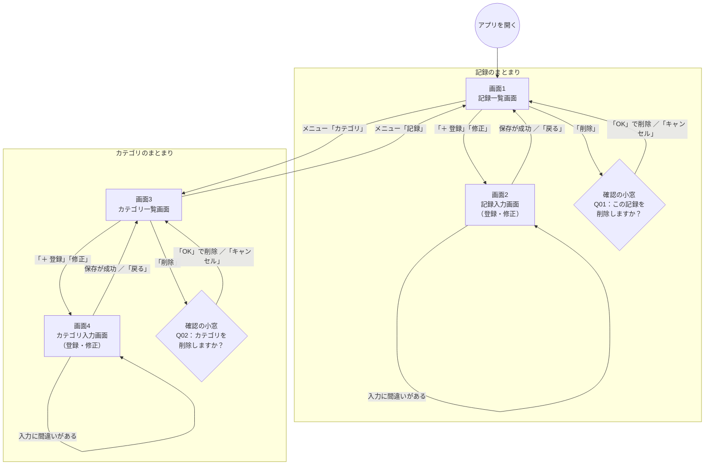

# 画面遷移図

[基本設計書（入口）](00_設計書.md) に戻る

どの画面から、どんな操作で、どの画面へ移るか（遷移）をまとめます。
各画面の中身（表示する項目・ボタンの動き）は [画面要件](../01_要件定義/05-0_画面一覧と共通ルール.md)、表示する文章は [メッセージ一覧](../01_要件定義/06_メッセージ一覧.md) を参照してください。

## 1. 図の見方

| 形 | 意味 |
|---|---|
| 丸 | アプリを開いたところ（始まり） |
| 四角 | 画面 |
| ひし形 | 確認の小窓（ブラウザの確認ダイアログ）。画面ではない |
| 矢印の上の文字 | 移るきっかけになる操作・条件 |

## 2. 全体の図

> 画面2・画面4からも、画面の上のメニュー（「記録」「カテゴリ」）で画面1・画面3に移れます。図が見にくくなるため、矢印は省いています（「3. 遷移の一覧」の 遷移15〜18 を参照）。

## 3. 遷移の一覧

図に書いた矢印を、1つずつ表にしたものです。試験（テスト）のときは、この表を使って全部の遷移を確かめます。

### 3-1. 記録のまとまり

| 番号 | 元の画面 | 操作・条件 | 移る先 | そのときに起きること |
|---|---|---|---|---|
| 遷移1 | （アプリを開く） | アドレスを開く | 画面1 記録一覧画面 | 今月の記録と合計を表示する |
| 遷移2 | 画面1 記録一覧画面 | 「＋ 登録」を押す | 画面2 記録入力画面 | 「登録」の状態で開く（最初の値が入る） |
| 遷移3 | 画面1 記録一覧画面 | 「修正」を押す | 画面2 記録入力画面 | 「修正」の状態で、その記録の内容を入れて開く |
| 遷移4 | 画面2 記録入力画面 | 「保存する」「更新する」を押し、保存が成功 | 画面1 記録一覧画面 | 完了のメッセージ（I01・I02）を出す。保存した記録の月を表示する |
| 遷移5 | 画面2 記録入力画面 | 「保存する」「更新する」を押し、入力に間違いがある | 画面2 記録入力画面（そのまま） | 間違いのある項目の下に、メッセージ（E01〜E08・E13）を出す |
| 遷移6 | 画面2 記録入力画面 | 「戻る」を押す | 画面1 記録一覧画面 | 保存しない。直前に見ていた月を表示する |
| 遷移7 | 画面2 記録入力画面 | 修正しようとした記録が、すでに削除されていた | 画面1 記録一覧画面 | メッセージ（S02）を出す |
| 遷移8 | 画面1 記録一覧画面 | 「削除」を押す | 確認の小窓（Q01） | — |
| 遷移9 | 確認の小窓（Q01） | 「OK」を押す | 画面1 記録一覧画面（そのまま） | 記録を削除し、完了のメッセージ（I03）を出す。一覧と合計を表示し直す |
| 遷移10 | 確認の小窓（Q01） | 「キャンセル」を押す | 画面1 記録一覧画面（そのまま） | 何もしない |

### 3-2. カテゴリのまとまり

| 番号 | 元の画面 | 操作・条件 | 移る先 | そのときに起きること |
|---|---|---|---|---|
| 遷移11 | 画面3 カテゴリ一覧画面 | 「＋ 登録」「修正」を押す | 画面4 カテゴリ入力画面 | 登録：最初の値が入る。修正：そのカテゴリの内容を入れて開く（種類は変えられない） |
| 遷移12 | 画面4 カテゴリ入力画面 | 保存が成功／入力に間違い／「戻る」／すでに削除されていた | 画面3、または画面4のまま | 記録のまとまりの 遷移4〜7 と同じ考え方。メッセージは I04・I05・E03・E09〜E11・S02 |
| 遷移13 | 画面3 カテゴリ一覧画面 | 「削除」を押す | 確認の小窓（Q02） | — |
| 遷移14 | 確認の小窓（Q02） | 「OK」／「キャンセル」を押す | 画面3 カテゴリ一覧画面（そのまま） | OK：削除して I06 を出す。ただし記録で使われているときは削除せず E12 を出す。キャンセル：何もしない |

### 3-3. 画面の上のメニュー（ヘッダー）

| 番号 | 元の画面 | 操作 | 移る先 |
|---|---|---|---|
| 遷移15 | すべての画面 | 「家計簿」（アプリの名前）を押す | 画面1 記録一覧画面（今月） |
| 遷移16 | すべての画面 | メニュー「記録」を押す | 画面1 記録一覧画面（今月） |
| 遷移17 | すべての画面 | メニュー「カテゴリ」を押す | 画面3 カテゴリ一覧画面 |
| 遷移18 | 画面2・画面4 | 入力の途中でメニューを押す | 押したメニューの画面（入力した内容は保存されない） |

### 3-4. そのほか

| 番号 | 元の画面 | 操作・条件 | 移る先 |
|---|---|---|---|
| 遷移19 | （どこでも） | 存在しないアドレスを開く | 「ページが見つかりません。」（S03）と、記録一覧画面へのリンクを表示する |
| 遷移20 | すべての画面 | ブラウザの「戻る」ボタンを押す | 1つ前に開いていた画面 |
