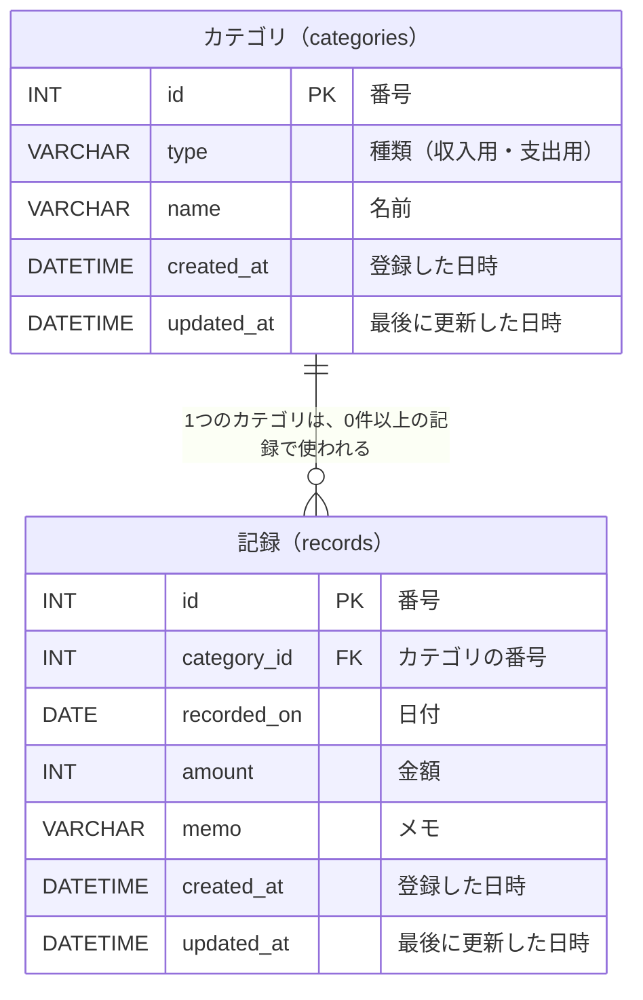

# ER図

[基本設計書（入口）](00_設計書.md) に戻る

どんなデータを、どんな形で保存し、データ同士がどうつながっているかをまとめます。
保存する項目のルールは [機能要件](../01_要件定義/04_機能要件.md) をもとにしています。

## 1. ER図とは

- **E**（Entity：エンティティ）＝ データの**まとまり**。データベースでは「テーブル（表）」になる
- **R**（Relationship：リレーションシップ）＝ まとまり同士の**つながり**

このアプリのまとまりは、「**カテゴリ**」と「**記録**」の2つです。

## 2. 図

### 図の見方

| 書き方 | 意味 |
|---|---|
| PK（主キー：Primary Key） | 1件1件を見分けるための番号。同じ番号は2つとない |
| FK（外部キー：Foreign Key） | ほかのまとまりの PK を指す項目。ここでは「記録」がどの「カテゴリ」かを表す |
| `||` | ちょうど1つ |
| `o{` | 0個以上（なくてもよいし、たくさんあってもよい） |

つまり、線の意味は次のとおりです。

- 1件の**記録**は、必ず**1つのカテゴリ**に属する
- 1つの**カテゴリ**は、**0件以上の記録**で使われる（まだ使われていないカテゴリもある）

## 3. それぞれのまとまり

### 3-1. カテゴリ（categories）

| 項目 | 名前（プログラムで使う名前） | 説明 |
|---|---|---|
| 番号 | id | 自動で付く番号（1, 2, 3…） |
| 種類 | type | 「収入用」か「支出用」。登録したあとは変えられない |
| 名前 | name | 例：食費、給料。同じ種類の中で同じ名前は登録できない |
| 登録した日時 | created_at | 自動で記録する |
| 最後に更新した日時 | updated_at | 自動で記録する |

### 3-2. 記録（records）

| 項目 | 名前（プログラムで使う名前） | 説明 |
|---|---|---|
| 番号 | id | 自動で付く番号（1, 2, 3…） |
| カテゴリの番号 | category_id | どのカテゴリの記録かを、カテゴリの番号で表す |
| 日付 | recorded_on | 収入・支出があった日 |
| 金額 | amount | 1円〜9,999,999円の整数 |
| メモ | memo | 100文字まで。なくてもよい |
| 登録した日時 | created_at | 自動で記録する |
| 最後に更新した日時 | updated_at | 自動で記録する |

## 4. 設計で工夫したところ

### 4-1. 記録に「種類（収入・支出）」を持たせない

画面では「種類」を選んでからカテゴリを選びますが、データベースの**記録には種類を保存しません**。

- 理由：カテゴリがすでに種類を持っているため。記録にも種類を保存すると、「記録は収入なのに、カテゴリは支出用」という**食い違いが起きる可能性**がある
- 記録の種類は、**つながっているカテゴリの種類**を見て判断する
- このように、同じ情報を2か所に持たないように整理することを「**正規化**」という

### 4-2. カテゴリの名前ではなく、番号でつなぐ

記録には「食費」という名前ではなく、カテゴリの**番号**を保存します。

- 理由：カテゴリの名前を「食費」→「食べ物」に直したとき、番号でつないでいれば、**カテゴリを1か所直すだけで、すべての記録に反映される**

### 4-3. 使われているカテゴリは、データベースでも削除できないようにする

「記録で使われているカテゴリは削除できない」というルールを、プログラムだけでなく**データベースの外部キーの仕組みでも守ります**。

- 理由：プログラムに間違いがあっても、つながりの切れた記録（どのカテゴリか分からない記録）ができないようにするため

## 5. 名前の付け方のルール

| 対象 | ルール | 例 |
|---|---|---|
| テーブルの名前 | 英語の複数形・小文字 | categories、records |
| 項目の名前 | 英語の小文字。単語の区切りは `_` | category_id、created_at |
| 日付の項目 | `〜_on` | recorded_on |
| 日時の項目 | `〜_at` | created_at |

プログラムで使う名前は英語にします（日本語の名前だと、プログラムでトラブルが起きやすいため）。資料では日本語の名前と並べて書きます。
