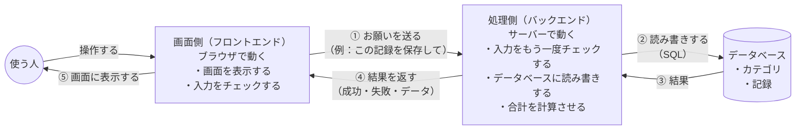
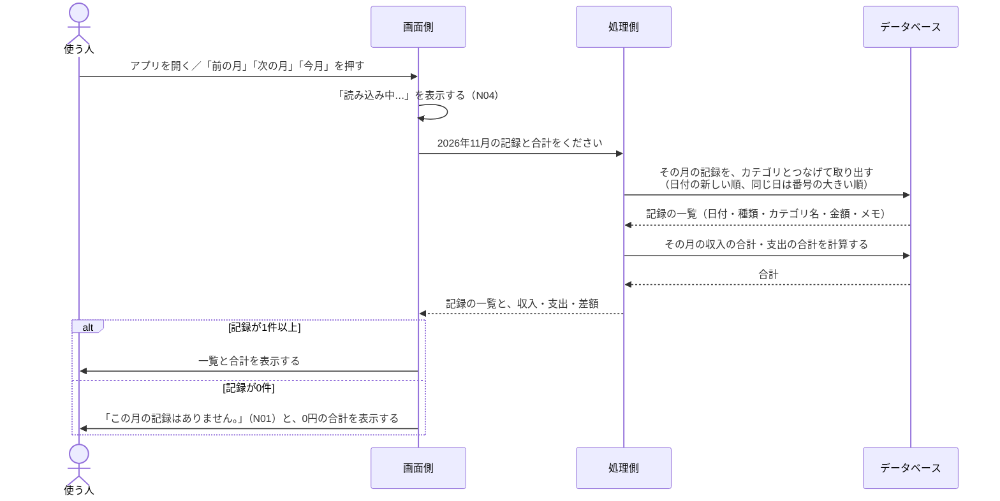
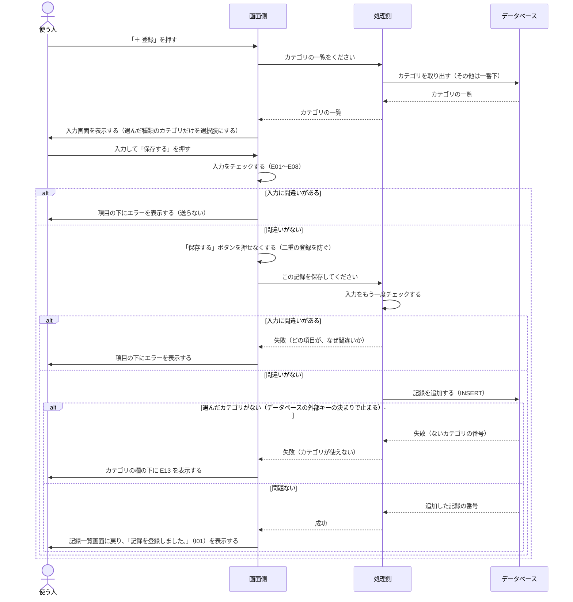
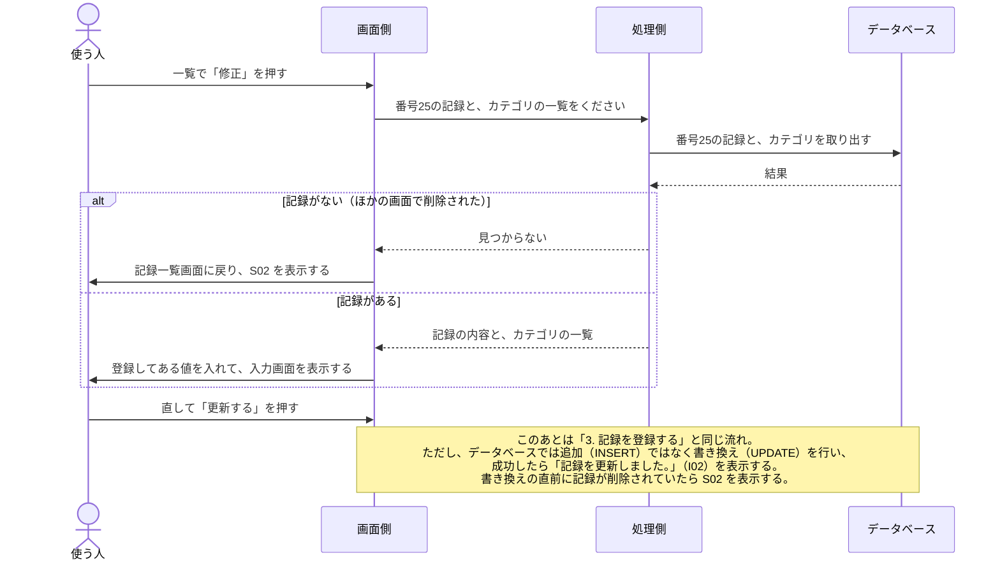
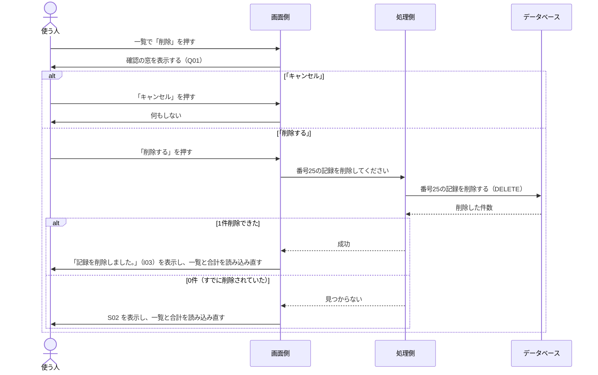
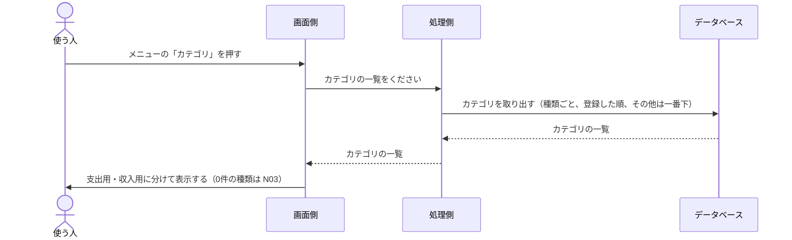
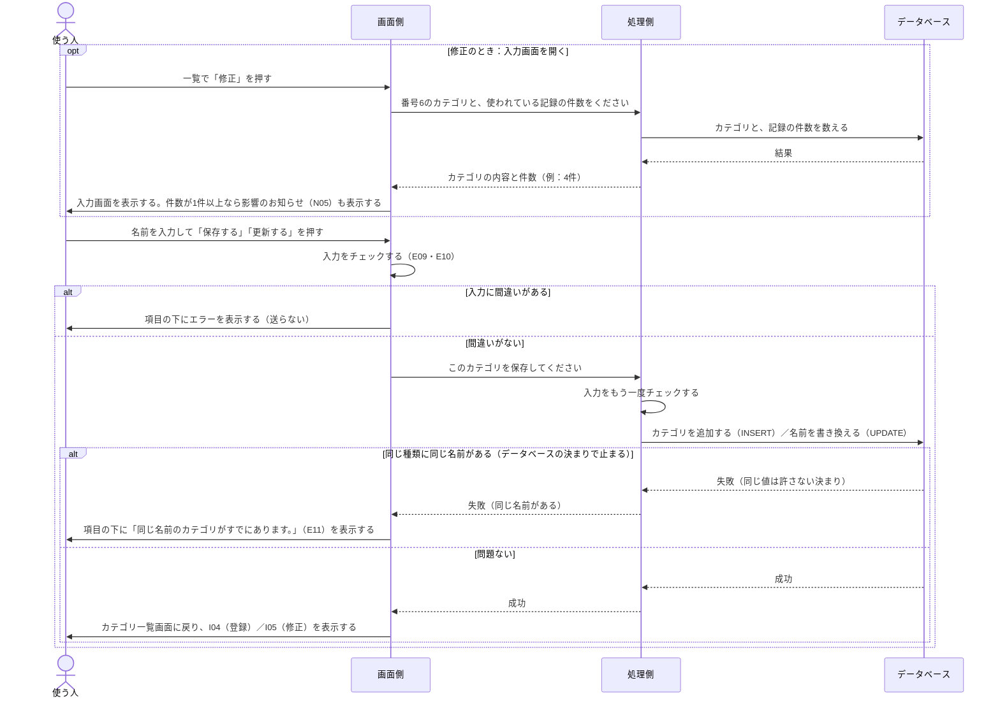
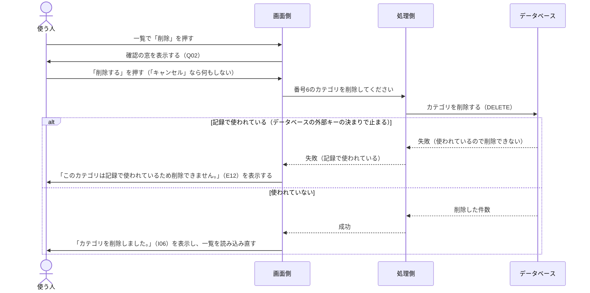
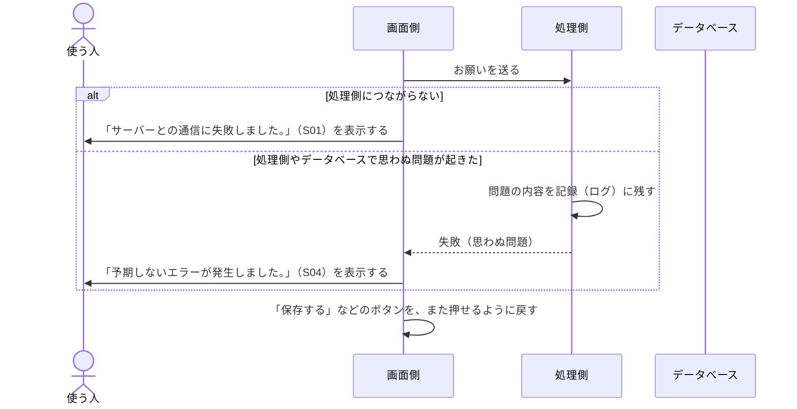
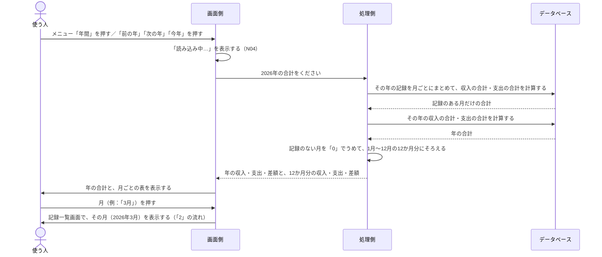

# データの流れ

[設計書（入口）](00_設計書.md) に戻る

画面で操作したときに、データが **画面側 → 処理側 → データベース** とどう動き、結果がどう戻ってくるかをまとめます。
画面の動きは [画面要件](../01_要件定義/05-0_画面一覧と共通ルール.md)、表示する文章は [メッセージ一覧](../01_要件定義/06_メッセージ一覧.md)、保存するデータの形は [ER図](03_ER図.md) を参照してください。

> やりとりの細かい決まり（送るデータの名前や形、アドレスなど）は [API 設計書](06_API設計書.md) を参照してください。

## 1. 全体の形

### 3つの部品の役割分担

| 部品 | すること | しないこと |
|---|---|---|
| 画面側 | 画面の表示、入力のチェック（使う人にすぐ間違いを知らせるため）、お知らせの表示 | データベースに直接つなぐこと |
| 処理側 | 入力のもう一度のチェック、データベースへの読み書き、結果を返すこと | 画面を作ること |
| データベース | データの保存、決まり（外部キー・チェック）を守ること、合計の計算（SQL） | — |

- **画面側はデータベースに直接つながない**。必ず処理側を通す
  - 理由：データベースのパスワードを画面側（使う人のブラウザ）に置くと、誰でも見られてしまうため
- **合計の計算は、データベース（SQL）に任せる**
  - 理由：記録を全部画面側に送ってから足し算するより、送るデータが少なく済み、計算の間違いも起きにくいため

---

## 2. 記録一覧画面を開く・月を切り替える（機能2・5）

## 3. 記録を登録する（機能1）

- 選んだカテゴリがあるかどうかは、**先に調べずに、データベースの外部キーの決まりに任せる**
  - 理由：先に調べてから追加すると、その間にほかの画面でカテゴリが削除されたときに、すり抜けてしまうため（「7」「8」と同じ考え方）

## 4. 記録を修正する（機能3）

## 5. 記録を削除する（機能4）

## 6. カテゴリ一覧画面を開く（機能7）

## 7. カテゴリを登録する・修正する（機能6・8）

- 同じ名前かどうかの確認は、**データベースの決まり（同じ値を許さない決まり）に任せる**
  - 理由：処理側で先に調べてから追加すると、調べた直後にほかの人が同じ名前を登録したときに、すり抜けてしまうため

## 8. カテゴリを削除する（機能9）

- 使われているかどうかの確認も、**データベースの外部キーの決まりに任せる**（理由は「7」と同じ）

## 9. 通信に失敗したとき（すべての操作に共通）

- 使う人には、問題のくわしい内容（データベースのエラーの文章など）は**見せない**
  - 理由：くわしい内容には、攻撃の手がかりになる情報が含まれることがあるため。くわしい内容は処理側の記録（ログ）だけに残す

## 9-2. 年間集計画面を開く・年を切り替える（機能10、2026年11月4日に追加）

- 合計の計算は、月ごとの合計（「2」）と同じく、**データベース（SQL）に任せる**
- 12か月分にそろえるのは処理側で行う（画面側は、返ってきた12行をそのまま表示するだけでよいようにするため）

---

## 10. まとめ：操作ごとのデータの流れ

| 操作 | 画面側 → 処理側（送るもの） | 処理側 → データベース | 処理側 → 画面側（返すもの） |
|---|---|---|---|
| 記録の一覧・合計 | 年月 | 記録を取り出す（SELECT）、合計を計算する（SUM） | 記録の一覧、収入・支出・差額 |
| 記録の登録 | 日付・カテゴリの番号・金額・メモ | 記録を追加する（INSERT）。ないカテゴリなら外部キーの決まりで止まる | 成功／失敗（項目ごとのエラー） |
| 記録の修正（開く） | 記録の番号 | 記録を取り出す（SELECT） | 記録の内容 |
| 記録の修正（保存） | 記録の番号・日付・カテゴリの番号・金額・メモ | 記録を書き換える（UPDATE）。ないカテゴリなら外部キーの決まりで止まる | 成功／失敗 |
| 記録の削除 | 記録の番号 | 記録を削除する（DELETE） | 成功／見つからない |
| カテゴリの一覧 | なし | カテゴリを取り出す（SELECT） | カテゴリの一覧 |
| カテゴリの登録 | 種類・名前 | カテゴリを追加する（INSERT） | 成功／失敗（同じ名前） |
| カテゴリの修正（開く） | カテゴリの番号 | カテゴリを取り出す、記録の件数を数える（COUNT） | カテゴリの内容、使われている件数 |
| カテゴリの修正（保存） | カテゴリの番号・名前 | 名前を書き換える（UPDATE） | 成功／失敗（同じ名前） |
| カテゴリの削除 | カテゴリの番号 | カテゴリを削除する（DELETE） | 成功／失敗（使われている） |
| 年ごとの合計 | 年 | 月ごとの合計と、年の合計を計算する（SUM・GROUP BY） | 年の収入・支出・差額、12か月分の収入・支出・差額 |

- 記録を送るときは、**種類（収入・支出）は送らない**。種類はカテゴリが持っているため（[ER図](03_ER図.md) の「記録に種類を持たせない」を参照）

## 11. まとめ：入力のチェックをどこで行うか

同じチェックを、**画面側・処理側・データベースの3か所**で重ねて行います。

| チェック | 画面側 | 処理側 | データベース | メッセージ |
|---|---|---|---|---|
| 日付が空・正しくない・範囲外 | ○ | ○ | ○（範囲） | E01・E02 |
| カテゴリを選んでいない | ○ | ○ | ○（空を許さない） | E04 |
| 選んだカテゴリが今もある（ほかの画面で削除されていない） | — | — | ○（外部キー） | E13 |
| 金額が空・整数でない・範囲外 | ○ | ○ | ○（範囲） | E05〜E07 |
| メモが100文字より多い | ○ | ○ | ○（文字数） | E08 |
| カテゴリ名が空・20文字より多い | ○ | ○ | ○ | E09・E10 |
| 同じ種類に同じ名前がある | — | — | ○（同じ値を許さない） | E11 |
| 記録で使われているカテゴリの削除 | — | — | ○（外部キー） | E12 |

| 場所 | なぜチェックするのか |
|---|---|
| 画面側 | 使う人に、**すぐに**間違いを知らせるため（送る前に分かる） |
| 処理側 | 画面側のチェックは、くわしい人ならすり抜けられるため。**ここが本当の守り** |
| データベース | 処理側のプログラムに間違いがあっても、**おかしなデータが保存されない**ようにする最後の守り |
