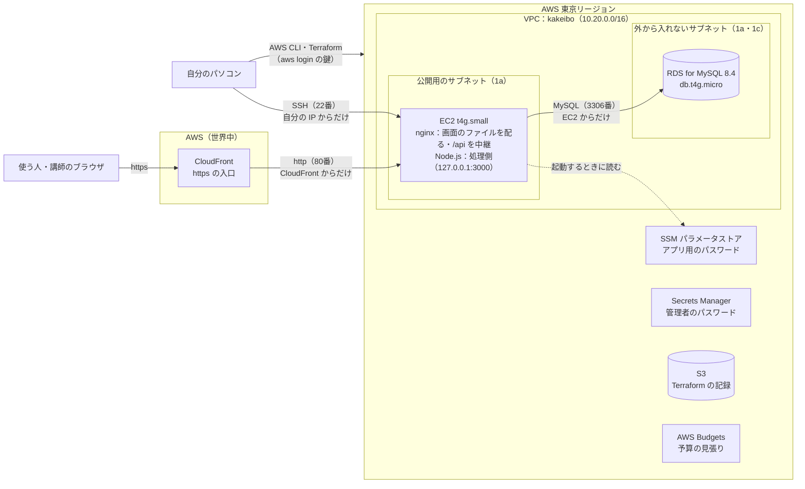
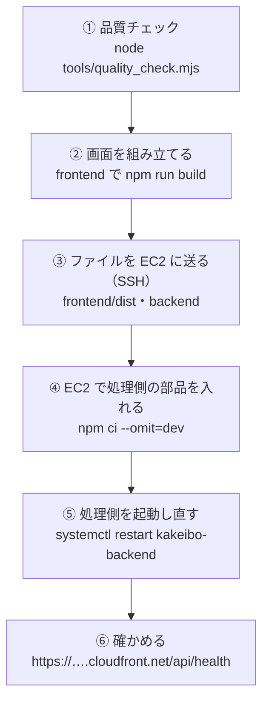

# 構成設計書（AWS での動かし方）

[設計書（入口）](00_設計書.md) に戻る

このアプリを、**AWS の上にどう置いて動かすか**を決める資料です。
ここで決めた形を、Terraform（IaC）のファイル（`infra/` フォルダ）に書いて作ります。

> AWS・Terraform の言葉や考え方は、[AWS と Terraform の基礎知識](../03_手順書/05_AWSとTerraformの基礎知識.md) を先に読んでください。

## 1. 守る条件

この資料は、次の条件を満たすように決めています。

| 条件 | どこで決めたか |
|---|---|
| 本番環境は AWS の **EC2 と RDS**（東京リージョン） | [課題の条件](../01_要件定義/01_課題の条件.md)・[非機能要件](../01_要件定義/07_非機能要件.md) 6-2 |
| **誰でも見られる**（ログインなし）・**24時間**使える | 非機能要件 1・5 |
| アドレスは **`https://`** | 非機能要件 5 |
| データベースは、**EC2 からだけ**つなげる | 非機能要件 5 |
| サーバーの管理用の入口は、**自分だけ**が使える | 非機能要件 5 |
| パスワードなどの秘密は、**GitHub に上げない** | 非機能要件 5 |
| データの控え（バックアップ）は **7日分** | 非機能要件 1 |
| 費用は **月5,000円以内**。**月4,000円をこえそうならメール** | 非機能要件 3-1 |
| 講師の確認が終わったら、**全部消す** | 非機能要件 3-1 |
| AWS の操作は、マネジメントコンソールを使わず、**AWS CLI と Terraform** で行う | 2026年11月3日に決めた進め方 |

## 2. 決めたこと

| 項目 | 決めたこと | 選ばなかったもの（理由） |
|---|---|---|
| https | **CloudFront** を EC2 の前に置く。アドレスは `https://（ランダムな文字）.cloudfront.net` | 独自ドメインを買う（お金と手間が増える）。ロードバランサー（ALB）を置く（月20ドルほどかかり、独自ドメインも必要） |
| ネットワーク | このアプリ専用の **VPC** を新しく作る。EC2 は公開用のサブネット、RDS は外から入れないサブネットに置く | 最初からある VPC（デフォルト VPC）を使う（どこまでが家計簿のものか分かりにくい。データベースを外から入れない場所に置けない） |
| サーバー | **EC2 t4g.small**（Arm、メモリ 2GB）、Amazon Linux 2023 | t4g.micro（メモリ 1GB。2026年12月31日までの無料トライアルの対象外） |
| データベース | **RDS for MySQL 8.4.11**（db.t4g.micro、1台） | 2台で動かす（マルチ AZ）（料金が2倍になる。止まっても1日以内に直せばよい決まりなので要らない） |
| 管理用の入口 | **SSH**。22番の入口を、自分のパソコンの IP アドレスからだけ開ける | Session Manager（入口を開けずに済むが、道具が増え、ファイルの送り方も別に考える必要がある） |
| Terraform の記録（ステート） | **S3** に置く。上書きしても前の版に戻せるようにする | 自分のパソコンに置く（パソコンが壊れると、作ったものを Terraform で消せなくなる） |
| 秘密の情報 | データベースの管理者のパスワードは **RDS が作って Secrets Manager** に置く。アプリ用のパスワードは **Terraform が作って SSM パラメータストア**（暗号化）に置く。どちらも Terraform の記録に残らない書き方にする | `.tfvars` やファイルに書く（間違えて GitHub に上げる危険がある） |
| 費用の見張り | **AWS Budgets** で月の予算を作り、こえそうになったらメールで知らせる | — |

### MySQL の版について

| 場所 | 版 | 理由 |
|---|---|---|
| 自分のパソコン（Docker） | 8.4.13 | 作ったときの最新 |
| 本番（RDS） | **8.4.11** | 2026年11月4日の時点で、RDS で使える一番新しい版（`aws rds describe-db-engine-versions` で確認） |

どちらも長期サポート版（LTS）の 8.4 系で、違うのは修正版の番号だけです。このアプリが使う機能（テーブル・外部キー・照合順序 `utf8mb4_bin`）は同じように動きます。RDS で 8.4.13 が使えるようになったら、そろえることを考えます（[開発環境と版の一覧](../03_手順書/00_開発環境と版の一覧.md) に記録する）。

## 3. 構成図

### お願い（リクエスト）の通り道

| 順番 | 通るところ | 内容 |
|---|---|---|
| 1 | ブラウザ → CloudFront | `https://（ランダムな文字）.cloudfront.net` を開く。CloudFront が https の証明書を出す |
| 2 | CloudFront → EC2 の nginx | AWS の中を http で送る。EC2 の 80番は、**CloudFront からの通信だけ**を通す |
| 3a | nginx（画面） | `/api` 以外は、画面のファイル（`frontend/dist`）を返す。ないパス（例：`/categories`）は `index.html` を返す（Vue Router が画面を切り替えるため） |
| 3b | nginx → Node.js（処理側） | `/api` で始まるお願いは、同じ EC2 の中の `127.0.0.1:3000` に中継する |
| 4 | Node.js → RDS | SQL を送る。RDS の 3306番は、**EC2 からの通信だけ**を通す |

自分のパソコンで動かしているときの形（[データの流れ](05_データの流れ.md)）と同じで、「画面 → 処理側 → データベース」の順につながります。自分のパソコンでは Vite が `/api` を中継していましたが、本番では nginx がその役をします。

## 4. ネットワーク

### 4-1. VPC とサブネット

| 名前 | アドレスの範囲 | 場所（アベイラビリティーゾーン） | 置くもの | インターネットとのつながり |
|---|---|---|---|---|
| VPC `kakeibo` | 10.20.0.0/16 | — | 全部 | インターネットゲートウェイ（出入口）を付ける |
| 公開用のサブネット | 10.20.1.0/24 | ap-northeast-1a | EC2 | あり（出入口への道を付ける） |
| 外から入れないサブネット 1 | 10.20.11.0/24 | ap-northeast-1a | RDS | **なし** |
| 外から入れないサブネット 2 | 10.20.12.0/24 | ap-northeast-1c | （RDS の決まりで必要） | **なし** |

- RDS は、2つ以上の場所（アベイラビリティーゾーン）にまたがるサブネットを指定する決まりがあるので、外から入れないサブネットを2つ作ります（RDS 本体は1台だけ）
- **NAT ゲートウェイ**（外から入れないサブネットから、インターネットへ出るための出口）は**作りません**。RDS はインターネットに出る必要がなく、NAT ゲートウェイは月45ドルほどかかるためです
- EC2 には**固定の住所（Elastic IP）**を付けます。EC2 を止めて動かしても住所が変わらず、CloudFront の設定を直さずに済みます

### 4-2. 門番（セキュリティグループ）

| 門番 | 入ってよい通信 | 相手 | 理由 |
|---|---|---|---|
| `kakeibo-app`（EC2） | 80番（http） | **CloudFront だけ**（AWS が用意している CloudFront の住所の一覧 `com.amazonaws.global.cloudfront.origin-facing`） | EC2 に直接 http で来られないようにし、必ず CloudFront の https を通す |
| `kakeibo-app`（EC2） | 22番（SSH） | **自分のパソコンの IP アドレスだけ** | 管理用の入口を自分だけにする |
| `kakeibo-db`（RDS） | 3306番（MySQL） | **`kakeibo-app` の門番が付いたもの（EC2）だけ** | データベースを EC2 からだけつなげるようにする |

- EC2 から外への通信（部品のダウンロードなど）は許します
- 自分のパソコンの IP アドレスは、家のネットの契約によって変わることがあります。SSH でつながらなくなったら、Terraform の設定（`my_ip`）を直して `apply` します

## 5. サーバー（EC2）

### 5-1. EC2 の設定

| 項目 | 決めたこと | 理由 |
|---|---|---|
| 大きさ | t4g.small（Arm、CPU 2つ、メモリ 2GB） | 2026年12月31日まで無料トライアル（月750時間）の対象。Node.js と nginx を動かすのに十分 |
| CPU の使い方 | standard（追加料金なし） | 負荷が続いても、追加料金がかからないようにする |
| OS | Amazon Linux 2023（Arm 用の最新のイメージ） | AWS が用意している Linux。長く更新される |
| ディスク | gp3、20GB、暗号化する | アプリとログには十分 |
| 情報の読み取り | トークンを必須にする（IMDSv2） | EC2 の中の情報を、不正に読まれにくくする |
| 権限（IAM ロール） | SSM パラメータストアの、家計簿のアプリ用のパスワードを読むことだけを許す | 必要な権限だけにする |

### 5-2. EC2 の中の組み立て

| 部品 | 版・設定 | 役割 |
|---|---|---|
| nginx | Amazon Linux 2023 に入っている版 | 80番で待ち受ける。画面のファイルを返す。`/api` を処理側に中継する |
| Node.js | **26.13.0**（自分のパソコンと同じ。Node.js の公式の Arm 用のファイルを入れる） | 処理側（Express）を動かす |
| 処理側（`backend/`） | `127.0.0.1:3000` で待ち受ける（EC2 の外からは直接つながらない） | API1〜11 |
| systemd（サービスの管理） | `kakeibo-backend` という名前で登録する | EC2 が起動したら、処理側も自動で起動する。止まったら自動で起動し直す |
| 処理側の設定 | `/etc/kakeibo/backend.env`（EC2 の中だけに置く） | `DB_HOST` などを書く。パスワードは、起動するときに SSM パラメータストアから読む |
| 画面（`frontend/dist`） | 自分のパソコンで `npm run build` して作ったもの | nginx が配る |

- EC2 が初めて起動したときに、nginx と Node.js を入れる手順（`user_data.sh`）を Terraform で渡します
- 処理側は、今の作り（`HOST`・`PORT`・`DB_HOST` などを環境変数で受け取る）のまま動かせます。本番用にプログラムを書き換える必要はありません

## 6. データベース（RDS）

### 6-1. RDS の設定

| 項目 | 決めたこと | 理由 |
|---|---|---|
| 種類と版 | MySQL **8.4.11** | 2章を参照 |
| 大きさ | db.t4g.micro（メモリ 1GB）、1台 | 一番小さい大きさ。10人・1万件の性能の目標に十分（自分のパソコンの性能の試験は、いちばん遅いもので 0.4 秒以内） |
| ディスク | gp3、20GB、暗号化する | 一番小さい大きさ |
| インターネットからの接続 | **できないようにする** | 非機能要件 5 |
| データの控え（自動バックアップ） | **7日分** | 非機能要件 1。無料プランのアカウントで 7日分が使えないと言われたら、1日分にして非機能要件を直す（作るときに確かめる） |
| 消すときの控え | 取らない | 講師の確認が終わったら全部消す決まりのため。**データも一緒に消える** |
| 消すことの禁止 | 付けない | `terraform destroy` で消せるようにするため |
| 時刻 | 日本時間（`time_zone = Asia/Tokyo`） | 自分のパソコンのデータベース（`TZ: Asia/Tokyo`）とそろえる |
| 文字コード | `utf8mb4`（MySQL 8.4 の初めからの設定） | 日本語を含むすべての文字を保存できる。テーブルの照合順序は `01_create_tables.sql` で決めている |

### 6-2. データベースの利用者

| 利用者 | 使う人 | パスワードの置き場所 | 使い道 |
|---|---|---|---|
| 管理者（`kakeibo_admin`） | 自分（EC2 から作業するとき） | Secrets Manager（RDS が作って、自動で変える） | テーブルを作る・お試しデータを戻す・アプリ用の利用者を作る |
| アプリ用（`kakeibo_app`） | 処理側（Node.js） | SSM パラメータストア（Terraform が作る） | 記録とカテゴリの読み書き（自分のパソコンと同じ名前） |

- テーブルとお試しデータは、自分のパソコンと同じ `database/sql/` の SQL を、EC2 から RDS に流して作ります
- お試しデータを戻すときも、同じ `database/reset/reset_data.sql` を使います（非機能要件 3-2）

## 7. CloudFront

| 項目 | 決めたこと | 理由 |
|---|---|---|
| 送り先（オリジン） | EC2 の公開用の名前（Elastic IP に付く `ec2-…amazonaws.com`）の 80番 | CloudFront は、IP アドレスではなく名前を指定する決まりのため |
| 使う人との通信 | **https だけ**。http で来たら https に移らせる | 非機能要件 5 |
| `/api/*` | **ためておかない**（毎回 EC2 に送る）。使う人からのお願いの中身（文字・月の指定など）をそのまま送る | 記録はいつも最新を見せる必要がある |
| `/assets/*` | ためておく（Vite が作るファイルは、中身が変わると名前も変わるため） | 速く表示できる |
| それ以外（`index.html` など） | ためておかない | 新しい版を載せたら、すぐに反映させるため |
| 配る範囲 | 日本を含む範囲（`PriceClass_200`） | 料金を少しおさえる |
| 証明書 | CloudFront が初めから持っている `*.cloudfront.net` の証明書 | 無料で、更新の手間もない |

## 8. Terraform のファイル（`infra/`）

### 8-1. ファイルの分け方

| ファイル | 書くもの |
|---|---|
| `versions.tf` | Terraform と AWS プロバイダーの版、ステートの置き場所（S3）、全部に付ける札（タグ） |
| `variables.tf` | 外から渡す値（自分の IP アドレス、通知のメールアドレス、大きさ など） |
| `network.tf` | VPC・サブネット・インターネットゲートウェイ・道案内（ルートテーブル） |
| `security.tf` | 門番（セキュリティグループ） |
| `compute.tf` | EC2・Elastic IP・SSH の公開鍵 |
| `user_data.sh` | EC2 が初めて起動したときに、nginx と Node.js を入れる手順 |
| `iam.tf` | EC2 に渡す権限 |
| `database.tf` | RDS・RDS の設定（パラメータグループ）・アプリ用のパスワード |
| `cdn.tf` | CloudFront |
| `budget.tf` | 予算の見張り |
| `outputs.tf` | 作ったあとに表示する値（公開のアドレス、SSH のコマンド など） |
| `terraform.tfvars.example` | 外から渡す値の見本（GitHub に上げる） |
| `terraform.tfvars` | 外から渡す本物の値（**GitHub に上げない**） |

### 8-2. 決まりごと

| 決まり | 内容 |
|---|---|
| 名前 | AWS に作るものの名前は、`kakeibo-` で始める（taskmanagement のものと区別するため） |
| 札（タグ） | 全部に `Project = kakeibo`・`ManagedBy = terraform` を付ける（家計簿のものを探しやすくするため） |
| 版の固定 | Terraform と AWS プロバイダーの版は、作るときに細かい版まで決めて書き、[開発環境と版の一覧](../03_手順書/00_開発環境と版の一覧.md) にも書く。`.terraform.lock.hcl`（プロバイダーの版の記録）は GitHub に上げる |
| GitHub に上げないもの | `terraform.tfvars`・`.terraform/`・`*.tfstate`・`*.tfplan`（`.gitignore` に書く） |
| ステートの置き場所 | S3 バケット `kakeibo-tfstate-（アカウントID）`。Terraform の外で、AWS CLI で先に作る。バケットの名前はコードに書かず、`terraform init` のときに渡す（リポジトリが公開のため） |
| 同時に動かさない | ステートにロック（同時に2つの作業をしないための札）を付ける（`use_lockfile = true`） |

## 9. アプリを載せる流れ（デプロイ）

- ①〜⑥ を1つの PowerShell のスクリプト（`deploy.ps1`）にまとめ、毎回同じ手順で載せられるようにします
- 初めてのときだけ、⑤の前に、テーブルとお試しデータを RDS に作ります（6-2）
- くわしい手順は、この資料のあとに作る「公開の手順書」に書きます

## 10. 費用の見積もり

### 10-1. 1か月の料金（東京、24時間つけっぱなし）

2026年11月4日に、AWS の料金表（`aws pricing get-products`）で確かめた値です。1か月は730時間として計算しています。

| もの | 料金の決まり | 1か月 | 2027年1月から |
|---|---|---|---|
| EC2 t4g.small | 1時間 0.0216 ドル（**2026年12月31日まで無料トライアル**、月750時間） | **0 ドル** | 15.77 ドル |
| EC2 のディスク（gp3、20GB） | 1GB で月 0.096 ドル | 1.92 ドル | 1.92 ドル |
| 固定の住所（Elastic IP） | 1時間 0.005 ドル | 3.65 ドル | 3.65 ドル |
| RDS db.t4g.micro（MySQL、1台） | 1時間 0.025 ドル | 18.25 ドル | 18.25 ドル |
| RDS のディスク（gp3、20GB） | 1GB で月 0.138 ドル | 2.76 ドル | 2.76 ドル |
| RDS の控え（7日分） | データベースの大きさ（20GB）までは無料 | 0 ドル | 0 ドル |
| Secrets Manager（管理者のパスワード） | 1つで月 0.40 ドル | 0.40 ドル | 0.40 ドル |
| SSM パラメータストア（標準） | 無料 | 0 ドル | 0 ドル |
| CloudFront | 毎月 1TB・1,000万回までは無料 | 0 ドル | 0 ドル |
| S3（Terraform の記録） | とても小さいファイルだけ | 0.01 ドル | 0.01 ドル |
| **合計** | | **約 27 ドル（約 4,000 円）** | **約 43 ドル（約 6,400 円）** |

- 円は **1ドル＝150円**として計算しています（為替で変わります）
- EC2 の無料トライアルの期限（2026年12月31日）は、taskmanagement の資料（2026年10月の時点）に書かれていた内容です。作ったあとに、請求の画面で 0 ドルになっているか確かめます
- 無料トライアルは**アカウント全体で月750時間**です。taskmanagement の EC2（t4g.small）も同時に動かすと、合わせて750時間をこえた分に料金がかかります

### 10-2. 月5,000円の上限との関係

| 時期 | 1か月の見込み | 上限（5,000円）との関係 |
|---|---|---|
| 2026年12月31日まで | 約 4,000 円 | **上限の中に収まる**。ただし、4,000円の通知にとても近い |
| 2027年1月から | 約 6,400 円 | **上限をこえる** |

- **講師の確認を、2026年12月中に終える**のが一番よい形です。2027年まで公開が続きそうなときは、その前に構成（大きさなど）を見直します
- 1か月の途中で作ったときは、その月は日割りになるので、見込みより少なくなります

### 10-3. 無料プランとクレジット

| 項目 | 状態（2026年11月4日に `aws freetier get-account-plan-state` で確認） |
|---|---|
| アカウントのプラン | **無料プラン**（Free plan） |
| 残りのクレジット | **139.18 ドル**（AWS の利用料に使える無料のお金。taskmanagement と共通） |
| 期限 | 2027年4月26日 |

- 無料プランのあいだは、料金は**クレジットから差し引かれ**、実際にお金を払うことはありません
- 上の見積もり（月約27ドル）なら、クレジットだけで約5か月分です。taskmanagement の RDS などが動くと、そのぶん早く減ります
- **クレジットを使い切るか、期限が来ると、アカウントが閉じます**（無料プランの決まり）。続けて使うときは、有料のプランに切りかえる必要があります

### 10-4. 予算の見張り（AWS Budgets）

| 項目 | 決めたこと |
|---|---|
| 予算の名前 | `kakeibo-monthly` |
| 金額 | 月 **33 ドル**（5,000円 ÷ 150円） |
| 通知 1 | 実際の金額が **27 ドル**（4,000円、予算の約80%）をこえたらメール（非機能要件 3-1） |
| 通知 2 | 月末までの見込みが **33 ドル**（5,000円）をこえそうならメール |
| 数え方 | **クレジットを差し引く前の金額**で数える（差し引いたあとの金額は 0 ドルになり、見張りにならないため） |
| 数える範囲 | 家計簿のもの（札 `Project = kakeibo`）だけ |
| 通知先 | `terraform.tfvars` に書くメールアドレス（GitHub に上げない） |

- 札（タグ）で絞りこむには、AWS の請求の仕組みに「`Project` の札を数えに使う」と伝える必要があります（AWS CLI の `aws ce update-cost-allocation-tags-status`）。伝えてから、使えるようになるまで最大で1日かかります
- 札が使えるようになるまでは、アカウント全体の金額で見張ります（taskmanagement の予算 `taskmanagement-monthly` もあるので、合わせて見ます）

## 11. 片付け（講師の確認が終わったら）

| 順番 | すること | コマンド |
|---|---|---|
| 1 | Terraform で作ったものを全部消す（EC2・RDS・CloudFront・VPC・予算など）。**RDS のデータも消える** | `terraform -chdir=infra destroy` |
| 2 | 家計簿のものが残っていないか確かめる | `aws resourcegroupstaggingapi get-resources --tag-filters Key=Project,Values=kakeibo` |
| 3 | ステートの S3 バケットを消す（Terraform の外で作ったため、1では消えない） | `aws s3 rb s3://kakeibo-tfstate-（アカウントID） --force` など（公開の手順書に書く） |
| 4 | 次の月の請求で、家計簿の料金が 0 になったことを確かめる | 請求の画面 |

- プログラムと資料は GitHub に残します（非機能要件 3-1）
- CloudFront は、消すまでに15分ほどかかります

## 12. やらないこと

| やらないこと | 理由 |
|---|---|
| 独自ドメイン | お金と手間が増える。`cloudfront.net` のアドレスで条件を満たせる |
| ロードバランサー（ALB）・台数を自動で増やす仕組み | 利用者が少なく、月20ドル以上かかる |
| NAT ゲートウェイ | RDS はインターネットに出る必要がない。月45ドルほどかかる |
| マルチ AZ（データベースを2台で動かす） | 料金が2倍になる。止まっても1日以内に直せばよい決まり（非機能要件 1） |
| WAF（攻撃を防ぐ仕組み） | 料金がかかる。お試しデータだけで、ログインもないため |
| 自動でデプロイする仕組み（CI/CD） | 1人で作業していて、`deploy.ps1` で十分 |
| EC2 に CloudFront 以外から来た http を、合言葉（決まったヘッダー）で見分ける仕組み | 80番は CloudFront の住所の一覧からしか入れないので、今回は入れない。必要になったら足す |

## 13. 作るときに確かめること

| 確かめること | どうするか |
|---|---|
| 無料プランのアカウントで、RDS の控えを 7日分にできるか | `apply` でエラーが出たら 1日分にして、非機能要件を直す |
| Amazon Linux 2023（Arm）で Node.js 26.13.0 が動くか | EC2 に SSH で入って `node -v` を確かめる |
| EC2 の無料トライアルが効いているか | 作った次の日に、請求の画面（または `aws ce get-cost-and-usage`）で確かめる |
| 画面の再読み込み（例：`/categories` で F5）で画面が出るか | 公開後の試験で確かめる（nginx が `index.html` を返す設定のため） |
| 公開後の試験 | [試験計画書](../04_試験/00_試験計画書.md) の「公開後の試験」を行う |
