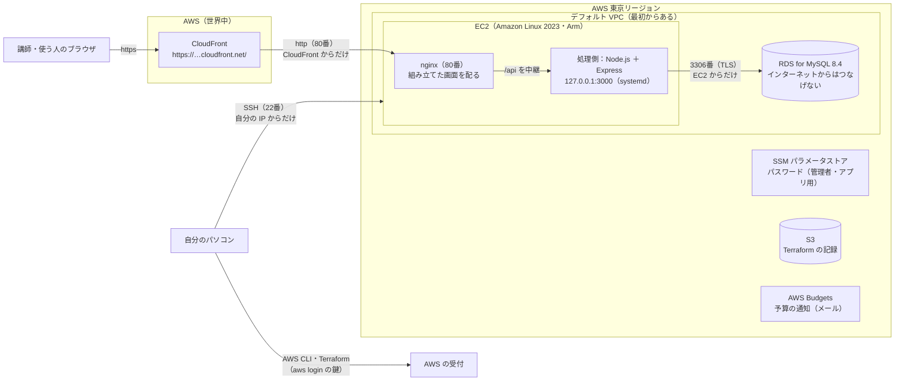

# 構成設計書（AWS での動かし方）

[設計書（入口）](00_設計書.md) に戻る

このアプリを、**AWS の上にどう置いて動かすか**（インフラの構成）をまとめた資料です。
ここに書いた形を、Terraform（IaC）のファイル（`infra/` フォルダ）で作ります。作り方・載せ方・消し方は [AWS への公開の手順書](../03_手順書/07_AWSへの公開の手順書.md) を参照してください。

> - AWS・Terraform の言葉や考え方は、[AWS と Terraform の基礎知識](../03_手順書/05_AWSとTerraformの基礎知識.md) を参照してください
> - 細かい設定値（版の細かい番号など）は変わることがあるので、この資料には書きません。版は [開発環境と版の一覧](../03_手順書/00_開発環境と版の一覧.md)、本当の値は `infra/` のファイルを正とします

## 1. 守る条件

| 条件 | どこで決めたか | どう満たすか |
|---|---|---|
| 本番環境は AWS の **EC2 と RDS**（東京リージョン） | [課題の条件](../01_要件定義/01_課題の条件.md) | EC2 で画面側と処理側を動かし、RDS のデータベースにつなぐ |
| **誰でも見られる**（ログインなし）・アドレスは **`https://`** | [非機能要件](../01_要件定義/07_非機能要件.md) 5 | CloudFront を前に置き、`https://…cloudfront.net/` で公開する |
| **24時間**使える | 非機能要件 1 | 処理側は systemd で動かし、止まっても自動で起動し直す。EC2 を起動し直しても自動で動き出す |
| データベースは **EC2 からだけ**つなげる | 非機能要件 5 | RDS はインターネットからつなげない設定にし、門番で EC2 からだけ通す |
| サーバーの管理用の入口は **自分だけ** | 非機能要件 5 | SSH（22番）は自分のパソコンの IP アドレスからだけ |
| パスワードなどの秘密は **GitHub に上げない** | 非機能要件 5 | パスワードは Terraform がその場で作り、SSM パラメータストアに置く（Terraform の記録にも残さない） |
| 費用は **月5,000円以内**、**4,000円をこえそうならメール** | 非機能要件 3-1 | 一番小さい構成にし、必要なときだけ作る。AWS Budgets で通知する |
| AWS の操作は、マネジメントコンソールを使わず、**AWS CLI と Terraform** で行う | 2026年11月3日に決めた進め方 | すべて `infra/` の Terraform と `infra/deploy.ps1` で行う |

## 2. インフラ構成図

### お願い（リクエスト）の通り道

| 順番 | 通るところ | 内容 |
|---|---|---|
| 1 | ブラウザ → CloudFront | `https://…cloudfront.net/` を開く。CloudFront が https の証明書を出す。`http://` で来たら `https://` に移らせる |
| 2 | CloudFront → EC2 の nginx（80番） | AWS の中を http で送る。EC2 の 80番は **CloudFront からだけ**通す |
| 3a | nginx（画面） | 組み立てた画面のファイルを返す。ないアドレス（`/categories` など）でも `index.html` を返す（Vue Router が画面を切り替えるため） |
| 3b | nginx → 処理側（127.0.0.1:3000） | `/api` で始まるお願いを中継する。処理側は EC2 の外からは直接つながらない |
| 4 | 処理側 → RDS（3306番） | SQL を送る（通信は TLS で暗号化）。RDS は **EC2 からだけ**通す |

自分のパソコンで動かしているときの形（[データの流れ](05_データの流れ.md)）と同じく、「画面 → 処理側 → データベース」の順につながります。自分のパソコンでは Vite が `/api` を中継しますが、本番では nginx が中継します。

## 3. 使う AWS のサービスと、主な設定

| サービス | 名前 | 主な設定 | 理由 |
|---|---|---|---|
| **EC2** | `kakeibo-app` | t4g.small（Arm、メモリ 2GB）、Amazon Linux 2023、ディスク gp3 8GB（暗号化）、トークン必須（IMDSv2）、CPU は standard（追加料金なし） | 画面側と処理側を同じ EC2 で動かす（シンプルな構成）。t4g.small は 2026年12月31日まで無料トライアルの対象 |
| **RDS** | `kakeibo-db` | MySQL 8.4 系、db.t4g.micro（1台）、ディスク gp3 20GB（暗号化）、インターネットからはつなげない、時刻 Asia/Tokyo、自動バックアップ1日分、版を勝手に上げない、消すときの控えは取らない | 一番小さい形。確かめたらすぐ消せるようにする |
| **CloudFront** | `kakeibo` | 送り先は EC2 の 80番、http は https に移らせる、`*.cloudfront.net` の証明書、`/api/*` はためない・`/assets/*` はためる・それ以外はためない | https と「誰でも見られる」を無料で満たす。記録はいつも最新を見せる |
| **セキュリティグループ**（門番） | `kakeibo-app`・`kakeibo-db` | 4章 | 必要な入口だけを開ける |
| **SSM パラメータストア** | `/kakeibo/db/admin-password`・`/kakeibo/db/app-password` | 暗号化（SecureString）。Terraform がその場で作り、書き込むだけ（記録に残さない） | 無料。Secrets Manager（1つ月 0.40 ドル）は使わない |
| **AWS Budgets** | `kakeibo-monthly` | 月 33 ドル（5,000円）。実際が 27 ドル（4,000円）をこえたら、月末の見込みが 33 ドルをこえそうならメール。クレジットを引く前の金額で、札 `Project = kakeibo` のものだけを数える | 非機能要件 3-1。通知先のメールアドレスは `terraform.tfvars` にだけ書く |
| **S3** | `kakeibo-tfstate-（アカウントID）` | 前の版に戻せる、インターネットに公開しない、暗号化。Terraform の外（AWS CLI）で作る | Terraform の記録（ステート）の置き場所。パソコンが壊れても記録が残る |
| **デフォルト VPC** | （最初からある） | 作らずに読むだけ | 専用の VPC を作ると、作るものが約10個増えるため |

- AWS に作るものの名前は `kakeibo-` で始め、すべてに札 `Project = kakeibo`・`ManagedBy = terraform` を付けます（同じアカウントの別のプロジェクト taskmanagement のものと区別するため）
- 請求の仕組みで札 `Project` を「数えに使う」と有効にしています（予算が家計簿のものだけを数えるため）

## 4. ネットワークと門番

| 門番 | 向き | ポート | 相手 | 理由 |
|---|---|---|---|---|
| `kakeibo-app`（EC2） | 入る | 22番（SSH） | **自分のパソコンの IP アドレスだけ** | 管理用の入口は自分だけ |
| `kakeibo-app`（EC2） | 入る | 80番（http） | **CloudFront だけ**（AWS が用意している CloudFront の住所の一覧） | 使う人は必ず CloudFront の https を通る。EC2 に直接 http では来られない |
| `kakeibo-app`（EC2） | 出る | すべて | どこへでも | OS の更新、部品のダウンロード、RDS への接続のため |
| `kakeibo-db`（RDS） | 入る | 3306番（MySQL） | **`kakeibo-app` の門番が付いたもの（EC2）だけ** | データベースは EC2 からだけ |

- どこからでも入れる設定（`0.0.0.0/0`）の入口はありません
- 処理側の 3000番は、EC2 の中（`127.0.0.1`）だけで待ち受けるので、外には開けません
- 自分のパソコンの IP アドレスが変わったら、`infra/terraform.tfvars` の `my_ip` を直して `apply` します

## 5. EC2 の中の組み立て

| もの | 置き場所・名前 | 動かし方 | 準備するところ |
|---|---|---|---|
| Node.js（npm も一緒） | `/opt/node-…`（`/usr/local/bin` から呼べる） | — | EC2 が初めて起動したときに、公式のファイルから入れる（`infra/user_data.sh.tftpl`）。ファイルが正しいか公式の一覧で確かめる |
| mysql コマンド | — | RDS にテーブルを作るときに使う | 同上（MySQL 公式の置き場所から） |
| git | — | アプリを GitHub から取ってくる | 同上 |
| nginx | 設定は `/etc/nginx/nginx.conf` | 80番で、組み立てた画面（`/var/www/kakeibo`）を配る。`/api` を処理側に中継する。nginx の版は返さない | 同上（設定も書く） |
| 処理側（バックエンド） | `/home/ec2-user/kakeibo-app/backend` | **systemd** の `kakeibo-backend`。EC2 が起動したら自動で動き、止まったら自動で起動し直す | 登録は起動のときに行う。アプリを置き `.env` を書くのは `infra/deploy.ps1` |
| 処理側の設定 | `backend/.env`（EC2 の中だけ。`ec2-user` だけが読める） | データベースの住所・利用者・パスワード | `infra/deploy.ps1` が書く。GitHub には上げない |
| 画面側（フロントエンド） | 組み立てたファイルを `/var/www/kakeibo` に置く | `npm run build` で組み立てる | `infra/deploy.ps1` が行う |
| アプリのファイル | `/home/ec2-user/kakeibo-app` | GitHub の `develop` ブランチ | `infra/deploy.ps1` が `git clone`（2回目からは取りこみ直す） |

## 6. データベース（RDS）の利用者とデータ

| 利用者 | 使う人 | パスワードの置き場所 | できること |
|---|---|---|---|
| 管理者 `kakeibo_admin` | `infra/deploy.ps1`（EC2 から作業するとき） | SSM パラメータストア（EC2 には読ませない。パソコンで読んで、SSH の中だけで渡す） | テーブルを作る・アプリ用の利用者を作る |
| アプリ用 `kakeibo_app` | 処理側（Node.js） | SSM パラメータストア（`deploy.ps1` が `.env` に書く） | 記録とカテゴリの読み書き（SELECT・INSERT・UPDATE・DELETE）だけ。テーブルを消すことはできない |

- テーブルとお試しデータは、自分のパソコンと同じ `database/sql/` の SQL を使います（カテゴリ17件・記録28件）
- RDS を作り直すと、データは空になります。`deploy.ps1` が、利用者・テーブル・お試しデータがないときだけ作ります

## 7. Terraform と、載せるためのスクリプト（`infra/`）

| ファイル | 書いてあるもの |
|---|---|
| `versions.tf` | Terraform と AWS プロバイダーの版、記録の置き場所（S3。バケット名は `init` のときに渡す）、全部に付ける札 |
| `variables.tf` | 外から渡す値（自分の IP アドレス、通知のメールアドレス、大きさ、版、予算の金額 など） |
| `network.tf` | デフォルト VPC とサブネットを読む（作らない） |
| `security.tf` | 門番（4章） |
| `compute.tf` | EC2・SSH の公開鍵 |
| `user_data.sh.tftpl` | EC2 が初めて起動したときに動く準備（5章）。中身を変えると EC2 を作り直す |
| `database.tf` | RDS・RDS の設定・サブネットのまとまり・パスワード2つ |
| `cdn.tf` | CloudFront |
| `budget.tf` | 予算の通知 |
| `outputs.tf` | 作ったあとに表示する値（公開のアドレス `app_url`、EC2 の住所、SSH のコマンド など） |
| `deploy.ps1` | アプリ（フロントエンド・バックエンド）を EC2 に載せるスクリプト（5・6章のアプリの部分をまとめて行う。何度動かしてもよい） |
| `terraform.tfvars.example` | 外から渡す値の見本（GitHub に上げる） |
| `terraform.tfvars` | 外から渡す本物の値（**GitHub に上げない**） |
| `.terraform.lock.hcl` | プロバイダーの版の記録（Terraform が作る。GitHub に上げる） |

- GitHub に上げないもの：`terraform.tfvars`・`.terraform/`・`*.tfstate`・`*.tfplan`（`.gitignore` に書いている）
- Terraform で作るものは15個（EC2 のまわり6つ、RDS のまわり7つ、CloudFront、予算）です

## 8. 費用と、置いておく期間

| もの | 1日（目安） | 1か月つけっぱなし（目安） |
|---|---|---|
| EC2 t4g.small | 0 ドル（2026年12月31日まで無料トライアル。2027年からは1日約 0.52 ドル） | 0 ドル（2027年からは約 15.8 ドル） |
| EC2 の公開の住所・ディスク | 約 0.15 ドル | 約 4.4 ドル |
| RDS（本体・ディスク） | 約 0.70 ドル | 約 21 ドル |
| CloudFront・AWS Budgets・SSM・門番・デフォルト VPC | 0 ドル（無料の範囲） | 0 ドル |
| S3（Terraform の記録） | ほぼ 0 ドル | 約 0.01 ドル |
| **合計** | **約 0.85 ドル（約 130 円）** | **約 25 ドル（約 3,800 円）** |

- 円は 1ドル＝150円として計算しています。料金は AWS の料金表（`aws pricing get-products`、2026年11月）で確かめた値です
- このアカウントは**無料プラン**で、料金はクレジットから引かれます（自分のお金は払いません）。クレジットを使い切るか期限が来ると、アカウントが閉じます
- **必要なときだけ作り、終わったら消します**。CloudFront のアドレスは作り直すたびに変わるので、講師にアドレスを伝えたら、講師の確認が終わるまでは消しません
- 2027年からは EC2 の無料トライアルが終わり、つけっぱなしだと月5,000円をこえます。その前に講師の確認を終えるか、EC2 を t4g.micro（`terraform.tfvars` の `instance_type`）にします

## 9. やらないこと

| やらないこと | 理由 |
|---|---|
| 専用の VPC（サブネット・出入口・道案内） | 作るものが約10個増える。デフォルト VPC と門番・「インターネットからつなげない」設定で守れる |
| NAT ゲートウェイ | RDS はインターネットに出る必要がない。月45ドルほどかかる |
| 独自ドメイン | お金と手間が増える。`cloudfront.net` のアドレスで条件を満たせる |
| ロードバランサー（ALB）・台数を自動で増やす仕組み | 利用者が少なく、月20ドル以上かかる |
| マルチ AZ（データベースを2台で動かす） | 料金が2倍になる。止まっても1日以内に直せばよい決まり（非機能要件 1） |
| Secrets Manager | 1つ月 0.40 ドルかかる。SSM パラメータストア（無料）で足りる |
| WAF（攻撃を防ぐ仕組み） | 料金がかかる。お試しデータだけで、ログインもないため |
| 自動でデプロイする仕組み（CI/CD） | 1人で作業していて、`deploy.ps1` で十分 |

## 10. まだ決めていないこと

| 非機能要件 | 今の構成 | どうするか |
|---|---|---|
| データの控え（バックアップ）は7日分 | 1日分 | 提出までに、7日分にするか、非機能要件を直すかを決める |
| お試しデータを戻す手順 | 戻す仕組みはない（作り直すと戻る） | 提出までに、戻す仕組みを作るか、非機能要件を直すかを決める |

## 11. この構成ができるまで（段階的に作った）

一気に作らず、1つ作るごとに動作を確かめてから次に進みました（2026年11月4日〜6日）。どの段階も、確かめたあとは料金がかからないように消しています。

| 段階 | 作ったもの | 確かめたこと |
|---|---|---|
| 第1段階 | EC2・門番・SSH の鍵 | 自分のパソコンから SSH で入れる。門番が自分の IP だけを通す |
| 第2段階 | EC2 が起動したときに Node.js を入れる | 自分のパソコンと同じ版が動く（Amazon Linux 2023 には、Node.js が使う部品 libatomic を先に入れる必要があった） |
| 第3段階 | RDS・RDS の門番・パスワード | EC2 からだけ RDS につながる（mysql コマンドの置き場所の探し方を Amazon Linux 2023 に合わせる必要があった） |
| 第4段階 | アプリを仮の形で載せる（開発用の Vite・手で起動） | 自分のパソコンのブラウザで画面とお試しデータが出る。`git pull` で載せ替えられる |
| 第5段階 | 本番らしい形（nginx・systemd・80番）、`deploy.ps1` | 処理側が止まっても、EC2 を起動し直しても、自動で動き出す。何もない状態からも `deploy.ps1` の1行で載せられる |
| 第6段階 | CloudFront（https）、予算の通知 | https で誰でも開ける。EC2 には直接つながらない |

それぞれの段階でつまずいたことと直し方は、[AWS への公開の手順書](../03_手順書/07_AWSへの公開の手順書.md) の「困ったとき」にまとめています。
