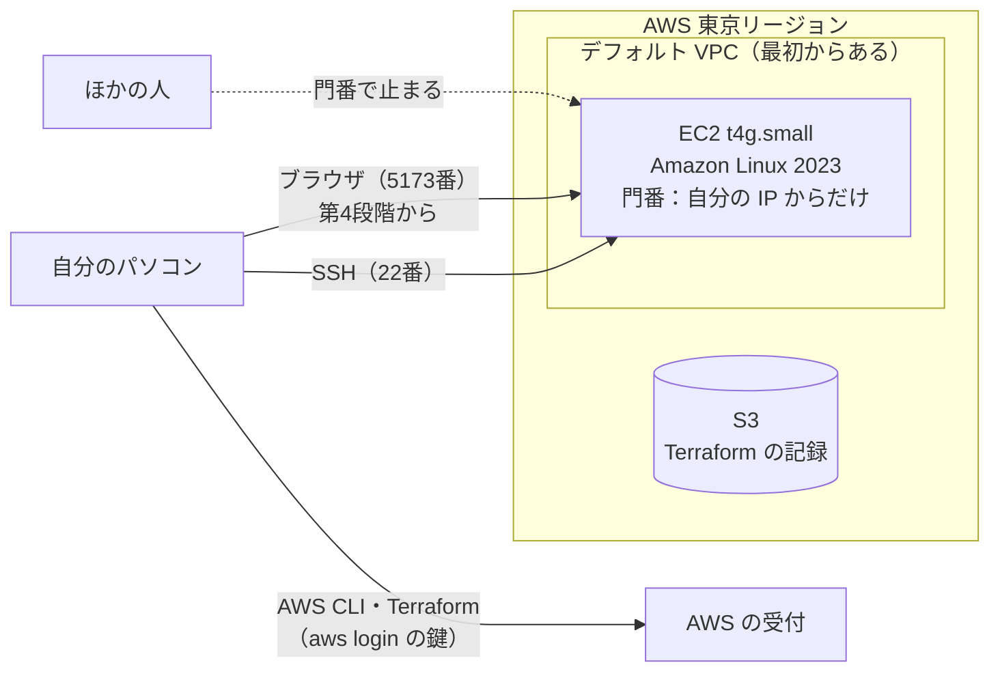
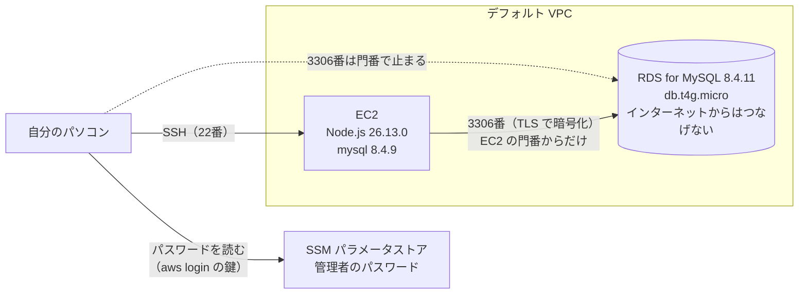

# 構成設計書（AWS での動かし方）

[設計書（入口）](00_設計書.md) に戻る

このアプリを、**AWS の上にどう置いて動かすか**を決める資料です。
ここで決めた形を、Terraform（IaC）のファイル（`infra/` フォルダ）に書いて作ります。

> AWS・Terraform の言葉や考え方は、[AWS と Terraform の基礎知識](../03_手順書/05_AWSとTerraformの基礎知識.md) を先に読んでください。

## 1. 進め方：段階的に作る

一気に全部を作らず、**1つ作るごとに動作を確かめてから、次に進みます**（2026年11月4日に決めた進め方）。

| 段階 | 作るもの・すること | 確かめること | 状態 |
|---|---|---|---|
| 第1段階 | **EC2**（と、EC2 の門番・SSH の鍵） | 自分のパソコンから SSH で入れる。門番が、自分のパソコンからの通信だけを通す | ✅ 完了（2026年11月4日） |
| 第2段階 | EC2 に Node.js を入れる（画面側と処理側を同じ EC2 で動かす準備） | `node -v` が自分のパソコンと同じ版 | ✅ 完了（2026年11月5日。4-5） |
| 第3段階 | **RDS**（MySQL）。EC2 からだけつなげる | EC2 から RDS につながる。EC2 以外からはつながらない | ✅ 完了（2026年11月5日。4-6） |
| 第4段階 | アプリを載せる（デプロイ）：処理側と画面側を EC2 で動かし、RDS につなぐ | 自分のパソコンのブラウザから `http://（EC2 の住所）:5173/` を開き、すべての機能が動く | これから |
| （そのあと） | 講師に見てもらう形にする（誰でも見られる・https など） | 非機能要件の残りの項目 | 第4段階のあとに決める |

- 各段階で決めたことと、作ったものは、この資料と [AWS デプロイガイド](../../AWSデプロイガイド.md) に書き足していきます。今 AWS に何があるかは、デプロイガイドの「0. 今の状態」で分かります
- 先に考えておいた形（RDS の設定・CloudFront での https・予算の見張り など）は、この資料の「8. あとの段階で使う予定の形」に残しています

## 2. 守る条件

| 条件 | どこで決めたか | 第1〜4段階での扱い |
|---|---|---|
| 本番環境は AWS の **EC2 と RDS**（東京リージョン） | [課題の条件](../01_要件定義/01_課題の条件.md) | EC2 は第1段階、RDS は第3段階で作る |
| 画面側と処理側は、**同じ EC2** に入れる（シンプルな構成） | 2026年11月4日に決めた進め方 | 第2・4段階 |
| 入れるのは**自分のパソコンからだけ** | 2026年11月4日に決めた進め方 | 門番で、自分のパソコンの IP アドレスからだけを通す（4-2） |
| サーバーの管理用の入口は、**自分だけ**が使える | [非機能要件](../01_要件定義/07_非機能要件.md) 5 | SSH（22番）を自分の IP からだけ |
| データベースは、**EC2 からだけ**つなげる | 非機能要件 5 | 第3段階 |
| パスワードなどの秘密は、**GitHub に上げない** | 非機能要件 5 | 第3段階から |
| AWS の操作は、マネジメントコンソールを使わず、**AWS CLI と Terraform** で行う | 2026年11月3日に決めた進め方 | すべての段階 |
| **誰でも見られる**・**`https://`**・24時間・予算の通知 | 非機能要件 1・3・5 | 第4段階のあとに決める（「そのあと」の段階） |

## 3. 決めたこと（第1段階）

| 項目 | 決めたこと | 選ばなかったもの（理由） |
|---|---|---|
| ネットワーク | アカウントに**最初からある VPC（デフォルト VPC）**を使う（作らずに読むだけ） | 専用の VPC を作る（サブネット・出入口・道案内など、作るものが約10個増える。個人の課題で、使う人もいないので、ここまでは要らない） |
| サーバー | **EC2 t4g.small**（Arm、メモリ 2GB）、Amazon Linux 2023、ディスク 8GB | t4g.micro（メモリ 1GB。2026年12月31日までの無料トライアルの対象外） |
| 公開の住所 | EC2 に自動で付く公開の住所を使う（固定の住所 Elastic IP は付けない） | Elastic IP（作るものが増える。止めて動かすと住所が変わるが、自分しか使わないので、そのつど `terraform output` で確かめればよい） |
| 管理用の入口 | **SSH**。22番を、自分のパソコンの IP アドレスからだけ開ける | Session Manager（入口を開けずに済むが、道具が増える） |
| 画面側の入口 | **5173番**（Vite。自分のパソコンで動かしているときと同じ）を、自分のパソコンの IP アドレスからだけ開ける | 80番の nginx（一般的な公開の形だが、入れるものが増える。誰でも見られる形にするときに考える） |
| Terraform の記録（ステート） | **S3** に置く。上書きしても前の版に戻せるようにする | 自分のパソコンに置く（パソコンが壊れると、作ったものを Terraform で消せなくなる） |
| 置いておく期間 | **必要なときだけ作り、確かめが終わったら消す**（Terraform なので、同じものをすぐ作り直せる） | ずっと置いておく（そのぶんクレジットが減る） |

> **軽くした理由**（2026年11月4日）：このアプリは個人の課題で、ログインもなく、ほかの人に使ってもらう予定もない。一般的なウェブアプリの構成にすると重くなるので、作るものと料金をできるだけ少なくし、段階的に作る。

## 4. 第1段階の構成

### 4-1. 構成図

- 第4段階では、同じ EC2 の中で、画面側（Vite、5173番）と処理側（Node.js ＋ Express、3000番）を動かします。画面側から処理側への `/api` の中継は、自分のパソコンのときと同じく Vite が EC2 の中で行うので、**3000番は外に開けません**

### 4-2. 門番（セキュリティグループ `kakeibo-app`）

| 向き | ポート | 相手 | 理由 |
|---|---|---|---|
| 入る | 22番（SSH） | **自分のパソコンの IP アドレスだけ**（`my_ip/32`） | EC2 の管理。自分だけが使える |
| 入る | 5173番（画面側の Vite） | **自分のパソコンの IP アドレスだけ**（`my_ip/32`） | 画面側を自分のパソコンのブラウザで開く |
| 出る | すべて | どこへでも | OS の更新や、Node.js・部品のダウンロードのため |

- **どこからでも入れる設定（`0.0.0.0/0`）の入口は作りません**
- 自分のパソコンの IP アドレスは、家のネットの契約によって変わることがあります。つながらなくなったら、`infra/terraform.tfvars` の `my_ip` を直して `apply` します（手順書の「IP アドレスが変わったとき」）

### 4-3. EC2

| 項目 | 決めたこと | 理由 |
|---|---|---|
| 大きさ | t4g.small（Arm、CPU 2つ、メモリ 2GB） | 2026年12月31日まで無料トライアル（月750時間）の対象。画面側と処理側を同じ EC2 で動かすのに十分 |
| CPU の使い方 | standard（追加料金なし） | 負荷が続いても、追加料金がかからないようにする |
| OS | Amazon Linux 2023（Arm 用の最新のイメージ） | AWS が用意している Linux。作ったあとは、新しいイメージが出ても作り直さない |
| ディスク | gp3、8GB、暗号化する | OS のイメージと同じ一番小さい大きさ |
| 置き場所 | デフォルト VPC の 1a のサブネット | — |
| 情報の読み取り | トークンを必須にする（IMDSv2） | EC2 の中の情報を、不正に読まれにくくする |
| 中に入れるもの | 第1段階では何も入れない。第2段階で Node.js を入れる（4-5） | 1つずつ確かめるため |

### 4-4. Terraform のファイル（第1段階）

| ファイル | 書くもの |
|---|---|
| `versions.tf` | Terraform と AWS プロバイダーの版、ステートの置き場所（S3）、全部に付ける札（`Project = kakeibo`・`ManagedBy = terraform`） |
| `variables.tf` | 外から渡す値（自分の IP アドレス、SSH の公開鍵、EC2 の大きさ、画面側のポート） |
| `network.tf` | デフォルト VPC とサブネットを読む（作らない） |
| `security.tf` | 門番（22番・5173番を自分の IP からだけ） |
| `compute.tf` | EC2・SSH の公開鍵 |
| `user_data.sh.tftpl` | EC2 が初めて起動したときに動く準備の手順（第2段階：Node.js／第3段階：mysql コマンド） |
| `database.tf` | RDS・RDS の設定・サブネットのまとまり・管理者のパスワード（第3段階） |
| `outputs.tf` | 作ったあとに表示する値（EC2 の住所、SSH のコマンド、画面側のアドレス） |
| `terraform.tfvars.example` | 外から渡す値の見本（GitHub に上げる） |
| `terraform.tfvars` | 外から渡す本物の値（**GitHub に上げない**） |

| 決まり | 内容 |
|---|---|
| 名前 | AWS に作るものの名前は、`kakeibo-` で始める（同じアカウントの taskmanagement のものと区別するため） |
| 版の固定 | Terraform と AWS プロバイダーの版は細かく決めて書き、[開発環境と版の一覧](../03_手順書/00_開発環境と版の一覧.md) にも書く。`.terraform.lock.hcl` は GitHub に上げる |
| GitHub に上げないもの | `terraform.tfvars`・`.terraform/`・`*.tfstate`・`*.tfplan`（`.gitignore` に書いている） |
| ステートの置き場所 | S3 バケット `kakeibo-tfstate-（アカウントID）`。Terraform の外で、AWS CLI で先に作る。名前はコードに書かず、`terraform init` のときに渡す（リポジトリが公開のため） |

Terraform で作るものは **6つ**です（SSH の鍵、門番、門番の入口2つ（22番・5173番）、門番の出口1つ、EC2）。

### 4-5. 第2段階：Node.js の入れ方（2026年11月5日）

| 項目 | 決めたこと | 理由 |
|---|---|---|
| 入れ方 | **Terraform の `user_data`**（EC2 が初めて起動したときに動く手順。`infra/user_data.sh.tftpl`）で、自動で入れる | EC2 は使わないときに消して作り直すので、手で入れると毎回同じ操作が要る。Terraform に書けば、作り直しても同じものが入る（坂本さんが選んだ） |
| 版 | **Node.js 26.13.0**（npm 11.20.0 が一緒に入る）。`infra/variables.tf` の `node_version` | 自分のパソコンと同じ版にそろえる |
| 取ってくる場所 | Node.js の公式のファイル（`nodejs.org/dist/` の linux-arm64） | EC2 が Arm のため。Amazon Linux 2023 の部品の一覧には、26 系がないため |
| ファイルの確かめ | 公式の一覧（`SHASUMS256.txt`）で、壊れたり、すりかえられたりしていないか確かめる | 安全のため |
| 先に入れる部品 | `libatomic`（と `tar`・`xz`） | Node.js が使う部品で、Amazon Linux 2023 に初めから入っていない。入れないと `node` が動かない（2026年11月5日に実際に起きた） |
| 置き場所 | `/opt/node-v26.13.0-linux-arm64`。`/usr/local/bin` から `node`・`npm`・`npx` を呼べるようにする | どこからでも打てるようにする |
| 手順を変えたとき | EC2 を作り直す（`user_data_replace_on_change = true`） | 起動したときの手順は、初めて起動したときにしか動かないため |

### 4-6. 第3段階：RDS（2026年11月5日）

| 項目 | 決めたこと | 理由 |
|---|---|---|
| 種類と版 | **RDS for MySQL 8.4.11** | 2026年11月5日の時点で、RDS で使える一番新しい 8.4 系。自分のパソコンは 8.4.13 で、違うのは修正版の番号だけ（このアプリが使う機能は同じ） |
| 大きさ | **db.t4g.micro**（1台・マルチ AZ なし）、ディスク gp3 20GB（暗号化） | 一番小さい形 |
| インターネットからの接続 | **できないようにする**（`publicly_accessible = false`）。RDS の住所は VPC の中だけで使う住所（172.31.…）になる | 非機能要件 5「データベースは EC2 からだけつなげる」 |
| 門番（`kakeibo-db`） | 3306番を、**EC2 の門番（`kakeibo-app`）が付いたものからだけ**通す。IP アドレスでは開けない | 同上。自分のパソコンからも直接はつなげない |
| 置き場所 | デフォルト VPC のサブネット（RDS の決まりで2つ以上の場所を指定。本体は1台） | 専用の VPC を作らない（3章） |
| 時刻 | `time_zone = Asia/Tokyo`（RDS の設定 `kakeibo-mysql84`） | 自分のパソコンのデータベース（`TZ: Asia/Tokyo`）とそろえる |
| データベースと管理者 | データベース `kakeibo`、管理者 `kakeibo_admin` | アプリ用の利用者（`kakeibo_app`）とテーブルは第4段階で作る |
| 管理者のパスワード | Terraform がその場で作り（ephemeral）、RDS には `password_wo`、SSM パラメータストアには `value_wo` で書き込むだけ。**Terraform の記録に残らない**。EC2 には読ませず、確かめるときはパソコンで読んで SSH の中だけで渡す | 秘密を GitHub にも記録にも残さない。Secrets Manager（月 0.40 ドル）は使わない |
| 自動バックアップ | **1日分**（坂本さんが選んだ） | 第3段階はつながるかを確かめるだけで、確かめたら消すため。非機能要件の7日分は、講師に見てもらうときに決める |
| 消すとき | 控えを取らない・消すことを禁止しない（`skip_final_snapshot`・`deletion_protection = false`） | 確かめたら `terraform destroy` ですぐ消せるようにする。**データも消える** |
| 版の固定 | `auto_minor_version_upgrade = false` | 勝手に版が上がらないようにする |
| 確かめ方 | EC2 に、MySQL 公式の `mysql` コマンド 8.4.9 を、起動したときに自動で入れる（坂本さんが選んだ）。MySQL 公式の置き場所（repo.mysql.com、el9 aarch64）を使い、Amazon Linux 2023 では置き場所の番号（`$releasever`）を `9` に置きかえる | 自分のパソコンのデータベースの手順書と同じ `mysql` コマンドで確かめられる。第4段階でテーブルを作るときにも使える。置き場所にある Arm 用の一番新しい 8.4 系が 8.4.9 だった |
| 料金 | RDS は1日約 0.70 ドル（本体 1時間 0.025 ドル・ディスク 1GB 月 0.138 ドル）。EC2 と合わせて**1日約 0.85 ドル** | クレジットから引かれる。確かめたら消す |

## 5. 費用（第1段階）

2026年11月4日に、AWS の料金表（`aws pricing get-products`）で確かめた値です。

| もの | 料金の決まり | 1日 | 1か月（730時間） |
|---|---|---|---|
| EC2 t4g.small | 1時間 0.0216 ドル（**2026年12月31日まで無料トライアル**、月750時間） | 0 ドル | 0 ドル（2027年からは 15.77 ドル） |
| EC2 のディスク（gp3、8GB） | 1GB で月 0.096 ドル | 約 0.03 ドル | 0.77 ドル |
| 公開の住所（IPv4） | 1時間 0.005 ドル | 0.12 ドル | 3.65 ドル |
| デフォルト VPC・門番・SSH の鍵 | 無料 | 0 ドル | 0 ドル |
| S3（Terraform の記録） | とても小さいファイルだけ | ほぼ 0 ドル | 0.01 ドル |
| **合計** | | **約 0.15 ドル（約 23 円）** | **約 4.4 ドル（約 660 円）** |

- 円は **1ドル＝150円**として計算しています
- このアカウントは**無料プラン**で、料金はクレジット（2026年11月4日の時点で残り 139.18 ドル、期限 2027年4月26日）から引かれます。**自分のお金を払うことはありません**。クレジットを使い切るか期限が来ると、アカウントが閉じます
- EC2 の無料トライアルは**アカウント全体で月750時間**です。taskmanagement の EC2（t4g.small、今は停止中）も同時に動かすと、合わせて750時間をこえた分に料金がかかります
- EC2 を止めているあいだは、EC2 本体と公開の住所の料金はかからず、ディスクの料金（1日約 0.03 ドル）だけになります

## 6. 片付け

確かめが終わったら、Terraform で作ったものを消します（`terraform -chdir=infra destroy`）。デフォルト VPC は Terraform で作ったものではないので消えません。ステートの S3 バケットと SSH の鍵は、次の段階で使うので残します。くわしい手順は [AWS デプロイガイド](../../AWSデプロイガイド.md) にあります。

## 7. 作るときに確かめること（第1段階）

| 確かめること | どうするか |
|---|---|
| 自分のパソコンから SSH で入れるか | `terraform output -raw ssh_command` のコマンドで入る |
| 自分のパソコン以外からは入れないか | 門番の入口が `my_ip/32` の2つだけで、`0.0.0.0/0` がないことを `aws ec2 describe-security-groups` で確かめる |
| OS と CPU の種類 | EC2 の中で `cat /etc/os-release`・`uname -m`（`aarch64` と出る＝Arm） |
| EC2 の無料トライアルが効いているか | 次の日に、請求の画面（または `aws ce get-cost-and-usage`）で確かめる |

## 8. あとの段階で使う予定の形（まだ決めていない）

2026年11月4日に、全部を一気に作る形で考えたものです。**今は作りません**。それぞれの段階に進むときに、坂本さんと相談して決め直します。考えたときのファイル（RDS・CloudFront・予算・デプロイのスクリプトなど）は、GitHub の記録（PR #14 の途中のコミット）に残っています。

| 段階 | 考えておいた形 |
|---|---|
| 第4段階（デプロイ） | 画面側と処理側のファイルを EC2 に送り、処理側を systemd（サービスの管理）で動かす。テーブルとお試しデータは `database/sql/` の SQL を使う |
| そのあと（講師に見てもらう形） | CloudFront（無料）を前に置いて `https://…cloudfront.net` で誰でも見られるようにする、80番の nginx で組み立てた画面を配る、予算の見張り（AWS Budgets、無料）でメールを送る など |
