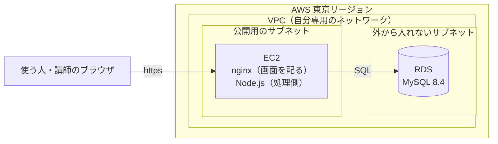
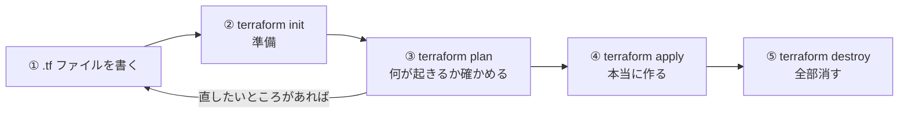

# AWS と Terraform の基礎知識

このアプリを AWS に公開する前に、知っておきたい言葉と考え方をまとめます。
**はじめて AWS を使う人**が読むことを前提に、できるだけやさしい言葉で書いています。

> 実際の設定の手順は、次の [AWS の認証設定の手順書](06_AWSの認証設定の手順書.md) に書いています。この資料は「なぜそうするのか」を分かるための読み物です。

## 0. この資料で分かること

| 章 | 内容 |
|---|---|
| 1 | AWS とは何か（クラウドの考え方） |
| 2 | このアプリで使う AWS のサービス |
| 3 | AWS のアカウントと「誰が操作しているか」（認証） |
| 4 | マネジメントコンソールと AWS CLI の違い |
| 5 | IaC（コードで作る）という考え方 |
| 6 | Terraform のしくみ |
| 7 | お金について気をつけること |
| 8 | 全体の流れ（これから何をするか） |

---

## 1. AWS とは

### 1-1. クラウドとは

ふつう、アプリを誰でも見られるように公開するには、**一日中動き続けるパソコン（サーバー）** が必要です。
昔は、自分でサーバーの機械を買い、置き場所と電源とネットを用意していました。

**クラウド**は、この「サーバーの機械」を、インターネットごしに**借りる**しくみです。

| | 自分で機械を買う | クラウドで借りる |
|---|---|---|
| 始めるまで | 機械を買って届くまで何日もかかる | コマンド1つで数分 |
| お金 | 最初にまとめて払う | 使った分だけ払う（時間・量に応じて） |
| やめるとき | 機械が手元に残る | 消せば、お金もかからなくなる |
| 壊れたとき | 自分で直す | 機械の故障は借りた先（AWS）が対応する |

### 1-2. AWS とは

**AWS（Amazon Web Services）** は、Amazon がやっているクラウドのサービスです。
サーバー、データベース、ファイル置き場など、200 以上のサービスがあります。
この課題では、**本番環境を AWS の EC2 と RDS で作る**ことが条件になっています（[課題の条件](../01_要件定義/01_課題の条件.md)）。

### 1-3. リージョン（地域）

AWS のデータセンター（機械が置いてある建物）は、世界中にあります。地域ごとのまとまりを**リージョン（Region）** といいます。

| 名前 | 場所 | このアプリ |
|---|---|---|
| `ap-northeast-1` | 東京 | **ここを使う**（日本から近いので速い） |
| `us-east-1` | アメリカ東部（バージニア北部） | 使わない（ただし、AWS 全体の設定の一部はここにある） |

> よくある失敗：コマンドや画面のリージョンが違っていて、「作ったはずのものが見えない」「知らないところでお金がかかっていた」。**いつも東京（`ap-northeast-1`）で作業する**と決めておきます。

---

## 2. このアプリで使う AWS のサービス

> ここに書くのは**だいたいの姿**です。正式な形は、このあと作る「構成設計書」で決めます。

| サービス | ひとことで | このアプリでの使い道 |
|---|---|---|
| **EC2**（Elastic Compute Cloud） | 借りられるパソコン（サーバー） | 処理側（Node.js ＋ Express）と、画面を配る nginx を動かす |
| **RDS**（Relational Database Service） | 借りられるデータベース | MySQL 8.4 を動かす。バックアップや更新を AWS が手伝ってくれる |
| **VPC**（Virtual Private Cloud） | AWS の中の、自分専用のネットワーク | EC2 と RDS をこの中に置く |
| **サブネット**（Subnet） | VPC をさらに区切った部屋 | 外から入れる部屋（公開用）と、外から入れない部屋（データベース用）に分ける |
| **セキュリティグループ**（Security Group） | サーバーごとの門番（ファイアウォール） | 「誰が・どの入口（ポート）から入ってよいか」を決める |
| **IAM**（Identity and Access Management） | 人やサーバーの「身分証」と「できること」の管理 | 自分のパソコンから AWS を操作する権限を管理する（3章） |

### だいたいの姿の図



- 使う人がつながれるのは EC2 だけ。**データベース（RDS）には、外から直接つながれない**ようにする（セキュリティグループで EC2 からだけ許す）
- 自分のパソコンで動かしている形（[データの流れ](../02_設計/05_データの流れ.md)）と同じで、「画面 → 処理側 → データベース」の順につながる

---

## 3. AWS のアカウントと認証

### 3-1. アカウント

**AWS アカウント**は、AWS を使うための「契約の単位」です。12けたの番号（アカウント ID）が付いています。
作ったもの・かかったお金は、すべてアカウントごとにまとまります。

### 3-2. ルートユーザーと IAM ユーザー

| 種類 | どんなもの | 使いかた |
|---|---|---|
| **ルートユーザー**（root user） | アカウントを作ったときのメールアドレスで入る。**何でもできる**（アカウントの解約も、お支払いの変更も） | ふだんは使わない。金庫にしまうイメージ。多要素認証（MFA）を必ず付ける |
| **IAM ユーザー**（IAM user） | アカウントの中に作る、作業用の利用者 | ふだんの作業はこちらで行う |

このアカウントには、作業用の IAM ユーザー **`admin-user`** がすでにあります（2026年11月3日に確認。管理者の権限 `AdministratorAccess` 付き、多要素認証（MFA）あり）。

### 3-3. 認証と認可

| 言葉 | 意味 | たとえ |
|---|---|---|
| **認証**（Authentication） | 「あなたは誰？」を確かめること | 社員証を見せて建物に入る |
| **認可**（Authorization） | 「あなたは何をしてよい？」を決めること | 社員証の種類で、入れる部屋が決まる |

AWS では、**IAM ポリシー**（Policy）という「できることの一覧」を、ユーザーに付けて認可します。

### 3-4. コマンドから操作するときの「鍵」

画面（マネジメントコンソール）ではパスワードでログインしますが、コマンド（AWS CLI や Terraform）から操作するときは、**認証情報（クレデンシャル、credentials）** という鍵を使います。鍵には2種類あります。

| 種類 | どんなもの | 安全さ |
|---|---|---|
| **長く使える鍵**（アクセスキー） | `AKIA` で始まる ID と、秘密の文字列の組み合わせ。消すまでずっと使える | **危ない**。パソコンにそのまま保存されるので、漏れると誰でもずっと使えてしまう（GitHub に間違えて上げてしまう事故が多い） |
| **一時的な鍵**（一時的な認証情報） | ログインするたびに作られ、**最長12時間で使えなくなる** | **安全**。漏れても、すぐに使えなくなる |

AWS は「**長く使える鍵はできるだけ使わず、一時的な鍵を使う**」ことをすすめています。
この資料のあとの手順書では、**`aws login`** という命令で、一時的な鍵を使えるようにします。

| やり方 | しくみ | このプロジェクト |
|---|---|---|
| `aws login` | ブラウザで AWS にログインすると、コマンド用の一時的な鍵が自動でもらえる（AWS CLI 2.32.0 から使える） | **これを使う** |
| IAM Identity Center（SSO） | 会社などで、たくさんの人・アカウントをまとめて管理するしくみ | 1人・1アカウントなので使わない（準備が多い） |
| アクセスキー（長く使える鍵） | 鍵をファイルに保存して使う | **使わない**（今あるものは、あとで止める。手順書の 7章） |

---

## 4. マネジメントコンソールと AWS CLI

AWS を操作する方法は、大きく2つあります。

| 方法 | どんなもの | よいところ | 困るところ |
|---|---|---|---|
| **マネジメントコンソール**（Management Console） | ブラウザで開く AWS の画面。ボタンを押して操作する | 見て分かりやすい | 同じことをもう一度するのが大変。何をしたか記録が残りにくい。画面の見た目がよく変わる |
| **AWS CLI**（Command Line Interface） | ターミナルにコマンドを打って操作する | 同じことを何度でも正確にできる。手順書にそのまま書ける | コマンドを覚える必要がある |

このプロジェクトでは、**画面でポチポチ操作するのではなく、コマンドで操作します**。
ただし、次のことは画面（ブラウザ）が必要です。

- `aws login` のときに、ブラウザで AWS にログインすること（多要素認証のため）
- 請求（お金）の確認（コマンドでもできますが、画面のほうが分かりやすい）

### AWS CLI のコマンドの形

```powershell
aws  sts  get-caller-identity  --profile kakeibo
#    ↑    ↑                    ↑
#    サービス名  命令            オプション（どの設定を使うか など）
```

### プロファイル

**プロファイル**（profile）は、「どのアカウントに・どの鍵で・どのリージョンで」つなぐかの設定に、名前を付けたものです。
`%USERPROFILE%\.aws\config`（坂本さんのパソコンでは `C:\Users\坂本　順治\.aws\config`）に書かれます。

このプロジェクトでは、**`kakeibo`** という名前のプロファイルを作って使います。
すでにある `default`（名前なし）のプロファイルは、別のプロジェクト（taskmanagement）でも使っているかもしれないので、混ざらないように分けます。

---

## 5. IaC（コードで作る）という考え方

### 5-1. IaC とは

**IaC（Infrastructure as Code、インフラのコード化）** は、サーバーやネットワークなどの**インフラ（土台）を、プログラムのようにファイルに書いて作る**考え方です。

料理にたとえると、次のようになります。

| | 手で作る（コンソール・コマンドを1つずつ） | IaC |
|---|---|---|
| たとえ | その場の思いつきで料理する | **レシピを書いて**、そのとおりに作る |
| もう一度作る | 何をしたか思い出しながら作る | レシピがあるので、同じものがすぐできる |
| 間違いの確認 | 作ったあとで気づく | 作る前に、レシピを見直せる（レビューできる） |
| 記録 | 残りにくい | ファイルなので Git で変更の記録が残る |
| 片付け | 作ったものを1つずつ探して消す | **コマンド1つで全部消せる** |

### 5-2. このプロジェクトで IaC がうれしい理由

- **講師の確認が終わったら、AWS のものを全部消す**決まりがあります（[非機能要件](../01_要件定義/07_非機能要件.md)）。消し忘れがあると、お金がかかり続けます。IaC なら1回のコマンドで全部消せます
- 失敗しても、消して作り直すのがかんたんです
- 「どんな形で AWS に置いたか」がファイルで残るので、提出物（GitHub）の中で講師にも見てもらえます

### 5-3. AWS CLI と Terraform の役割の違い

| 道具 | このプロジェクトでの役割 |
|---|---|
| **AWS CLI** | AWS にログインする（`aws login`）、つながっているかを確かめる、ちょっとした確認をする |
| **Terraform** | EC2・RDS・VPC などを**作る・変える・消す**（IaC の本体） |

Terraform は、AWS CLI でログインしたときの一時的な鍵を、そのまま使って AWS を操作します。

---

## 6. Terraform のしくみ

### 6-1. Terraform とは

**Terraform**（テラフォーム）は、HashiCorp という会社が作っている IaC の道具です。
`.tf` という名前のファイルに「こういうものがほしい」を書くと、Terraform が AWS に命令を出して、そのとおりに作ってくれます。

```hcl
# 例：「東京リージョンに、t4g.micro という大きさの EC2 を1台ほしい」
resource "aws_instance" "app" {
  ami           = "ami-xxxxxxxx"   # どの OS を入れるか
  instance_type = "t4g.micro"      # パソコンの大きさ
}
```

この書き方を **HCL**（HashiCorp Configuration Language）といいます。
「手順（どうやって作るか）」ではなく、「**ほしい姿**（何がほしいか）」を書くのが特ちょうです（宣言的（declarative）な書き方といいます）。

### 6-2. 大事な言葉

| 言葉 | 意味 |
|---|---|
| **プロバイダー**（provider） | Terraform と AWS の間に立って、AWS に命令を出す部品。AWS 用は `hashicorp/aws` |
| **リソース**（resource） | 作るもの1つ1つ（EC2 1台、セキュリティグループ1つ など） |
| **データソース**（data source） | 作らずに、AWS にすでにあるものの情報を読むだけのもの |
| **変数**（variable） | 外から値を渡せるところ（リージョン、パソコンの大きさ など） |
| **出力**（output） | 作ったあとに表示したい値（EC2 の住所（IP アドレス）など） |
| **ステート**（state、`terraform.tfstate`） | Terraform が「自分が何を作ったか」を覚えておくための記録ファイル |

### 6-3. ステート（state）について気をつけること

ステートは Terraform の「記憶」です。これがなくなると、Terraform は自分が作ったものを忘れてしまい、消すこともできなくなります。

| 気をつけること | 理由 |
|---|---|
| **GitHub に上げない** | データベースのパスワードなど、秘密の値がそのまま書かれることがある |
| なくさない | なくすと、作ったものを Terraform で消せなくなる（手で1つずつ探して消すことになる） |
| 手で書き換えない | Terraform の記憶と本当の姿がずれてしまう |

置き場所は「自分のパソコン」か「AWS の S3（ファイル置き場）」が選べます。どちらにするかは構成設計で決めます。

### 6-4. いつも使うコマンド



| コマンド | すること | AWS が変わるか | お金 |
|---|---|---|---|
| `terraform init` | プロバイダーなどの部品をダウンロードして準備する。最初に1回（設定を変えたときも） | 変わらない | かからない |
| `terraform fmt` | `.tf` ファイルの書き方（字下げなど）を整える | 変わらない | かからない |
| `terraform validate` | `.tf` ファイルに書き間違いがないか確かめる | 変わらない | かからない |
| `terraform plan` | 「今の AWS」と「ファイルに書いたほしい姿」を比べて、**何を作る・変える・消すかを表示するだけ** | 変わらない | かからない |
| `terraform apply` | plan の内容を表示し、`yes` と打つと**本当に作る・変える** | **変わる** | **かかり始める** |
| `terraform destroy` | Terraform で作ったものを**全部消す**。`yes` と打つと実行 | **変わる（消える）** | 止まる |

> いちばん大事な習慣：**apply の前に必ず plan を見る**。とくに `destroy`（消す）や `replace`（作り直す）と表示されていないかを確かめます。データベースが作り直されると、中のデータは消えます。

### 6-5. plan の読み方

```
  + create    … 新しく作る
  ~ update    … 今あるものを変える
  - destroy   … 消す
-/+ replace   … いったん消して、作り直す（中身が消えることがある）

Plan: 12 to add, 0 to change, 0 to destroy.
      ↑作る数     ↑変える数    ↑消す数
```

---

## 7. お金について気をつけること

AWS は**使った分だけお金がかかります**。このプロジェクトでは、**費用の上限を月 5,000 円**と決めています（[非機能要件](../01_要件定義/07_非機能要件.md)）。

| 気をつけること | 説明 |
|---|---|
| 止めても、お金がかかるものがある | EC2 を止めても、ディスク（EBS）や固定の住所（Elastic IP）にはお金がかかる |
| RDS は止めても7日で勝手に動き出す | 止めておけるのは7日まで。そのあと自動で起動して、お金がかかり始める |
| 使い終わったら消す | 講師の確認が終わったら `terraform destroy` で全部消す |
| 予算の見張りを付ける | 決めた金額をこえそうになったら、メールで知らせるしくみ（AWS Budgets）を付ける。これも Terraform で作る予定 |
| 無料で使える範囲がある | アカウントの作り方や時期によって、無料の範囲が違う。**無料だと思いこまず**、作る前に構成設計書で見積もる |

> このアカウントには、別のプロジェクト（taskmanagement）の EC2 と RDS が「停止中」で残っています（2026年11月3日に確認）。家計簿アプリとは関係ないので、この手順書では触りません。ただし、上に書いたとおり停止中でもお金がかかったり、RDS が7日で動き出したりするので、使わないなら、そちらのプロジェクトで片付けを考えてください。

---

## 8. 全体の流れ（これから何をするか）

| 順番 | すること | 資料 | AWS が変わるか |
|---|---|---|---|
| 1 | この資料で、言葉と考え方を知る | この資料 | 変わらない |
| 2 | 自分のパソコンから、コマンドで AWS につながるようにする | [AWS の認証設定の手順書](06_AWSの認証設定の手順書.md) | 変わらない |
| 3 | AWS の上にどう置くかを決める（構成図・費用の見積もり） | 構成設計書（これから作る） | 変わらない |
| 4 | Terraform のファイル（`infra/` フォルダ）を書いて、`plan` で確かめる | 公開の手順書（これから作る） | 変わらない |
| 5 | `apply` で本当に作り、アプリを載せる | 公開の手順書 | **変わる（お金がかかり始める）** |
| 6 | 公開後の試験をする | [試験計画書](../04_試験/00_試験計画書.md) | 変わらない |
| 7 | 講師の確認が終わったら `destroy` で全部消す | 公開の手順書 | **変わる（消える）** |

## 9. もっと知りたいとき（公式の資料）

| 内容 | リンク |
|---|---|
| AWS CLI の使い方（日本語） | [AWS CLI ユーザーガイド](https://docs.aws.amazon.com/ja_jp/cli/latest/userguide/cli-chap-welcome.html) |
| `aws login` のしくみ | [Login for AWS local development using console credentials](https://docs.aws.amazon.com/cli/latest/userguide/cli-configure-sign-in.html) |
| Terraform の入門（AWS） | [Get Started - AWS（HashiCorp）](https://developer.hashicorp.com/terraform/tutorials/aws-get-started) |
| Terraform の AWS プロバイダー | [hashicorp/aws（Terraform Registry）](https://registry.terraform.io/providers/hashicorp/aws/latest/docs) |
| AWS の料金の見積もり | [AWS Pricing Calculator](https://calculator.aws/) |
